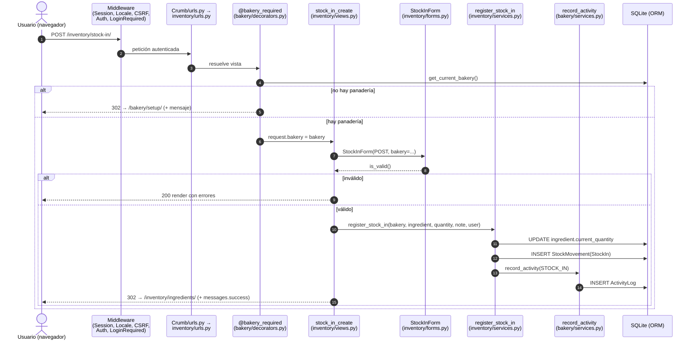
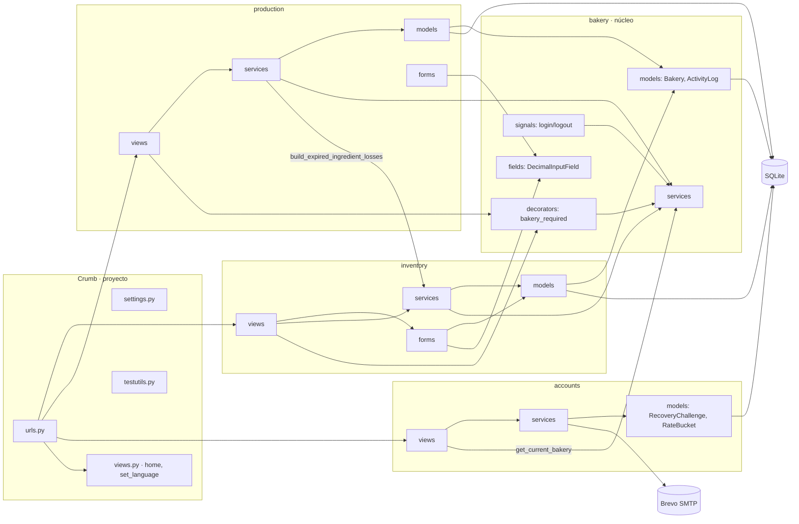
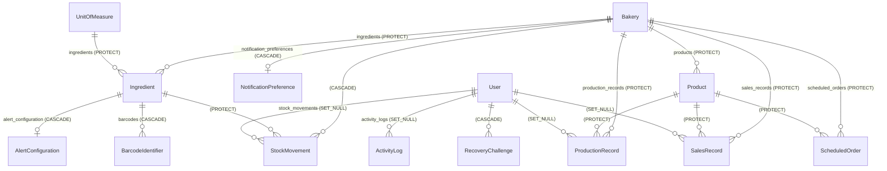

# CONTEXTO-TECNICO — Crumb

> Documento de contexto único del proyecto. Todo lo que aparece aquí se dedujo
> leyendo el código del repositorio (rama `main`, commit `23fa8f3`, 2026-11-09).
> Cuando algo no se pudo verificar en el código se indica con **"no verificado"**
> o **"no definido en el proyecto"**. Las rutas son relativas a la raíz del repo.
>
> Verificación ejecutada al redactarlo: `python manage.py test` → **337 tests, todos
> en verde** (164 fuera de `inventory` + 173 de `inventory`). `makemigrations --check`
> → *No changes detected* (los modelos y las migraciones están sincronizados).

---

## Índice

**Parte 1 — Qué es el proyecto**
1. [Propósito y alcance](#1-propósito-y-alcance)
2. [Stack](#2-stack)
3. [Estructura de carpetas](#3-estructura-de-carpetas)
4. [Arquitectura](#4-arquitectura)
5. [Modelo de datos](#5-modelo-de-datos)
6. [Puntos de entrada](#6-puntos-de-entrada)
7. [Configuración y entorno](#7-configuración-y-entorno)
8. [Integraciones y dependencias](#8-integraciones-y-dependencias)
9. [Decisiones técnicas](#9-decisiones-técnicas)
10. [Estado actual, deuda y riesgos](#10-estado-actual-deuda-y-riesgos)
11. [Glosario](#11-glosario)

**Parte 2 — Cómo se hacen las cosas aquí**

12. [Dónde va cada cosa nueva](#12-dónde-va-cada-cosa-nueva)
13. [Nombres](#13-nombres)
14. [Anatomía de un archivo típico](#14-anatomía-de-un-archivo-típico)
15. [Reglas de dependencia entre capas](#15-reglas-de-dependencia-entre-capas)
16. [Datos: validación, tipado, transformación y acceso a BD](#16-datos-validación-tipado-transformación-y-acceso-a-bd)
17. [Errores y logging](#17-errores-y-logging)
18. [Asincronía y efectos](#18-asincronía-y-efectos)
19. [Tests](#19-tests)
20. [Estilo y herramientas](#20-estilo-y-herramientas)
21. [Antipatrones](#21-antipatrones)

**Cierre**

- [A) Checklist antes de agregar código nuevo](#a-checklist-antes-de-agregar-código-nuevo)
- [B) Inconsistencias detectadas](#b-inconsistencias-detectadas)

---

# PARTE 1 — QUÉ ES EL PROYECTO

## 1. Propósito y alcance

**Qué hace.** Crumb es una aplicación web de servidor (Django, HTML renderizado en
el servidor) para gestionar el inventario y la operación diaria de **una panadería
pequeña**. Cubre:

| Área | Qué hace | Requisito (código FR) |
|---|---|---|
| Perfil del negocio | Alta y edición del perfil de la panadería | FR09, FR30 |
| Ingredientes | Alta, edición, baja lógica, categorías, búsqueda, filtro por fecha de caducidad | FR01, FR03, FR04, FR05, FR22/FR24, FR35 |
| Unidades de medida | Catálogo fijo de 4 unidades (kg, g, u, L) sembrado por migración | FR02 |
| Movimientos de stock | Entradas (compras), consumos, correcciones manuales con auditoría | FR07, FR08, FR23 |
| Códigos de barras | Asociar un código a un ingrediente y registrar entradas escaneando | FR17, FR18 |
| Alertas | Stock bajo y caducidad próxima / vencida; preferencias para apagarlas | FR06, FR10, FR11, FR29 |
| Importación / exportación | Importar ingredientes desde Excel/CSV; exportar inventario a XLSX y PDF | FR15, FR16 |
| Producción y ventas | Catálogo de productos, producción diaria, ventas diarias, sobrantes del día | FR12, FR13, FR14 |
| Reportes | Historial producción+ventas, ranking de ventas, reporte de pérdidas | FR25, FR36, FR26 |
| Pedidos programados | Registrar pedidos futuros de clientes | FR34 |
| Cuentas | Registro, login/logout, recuperación de contraseña por código de 6 dígitos enviado por email | FR31a, FR31b, FR32 |
| Auditoría | Registro de actividad de usuarios (login, logout, entrada de stock, corrección, venta) | FR28 |
| Idiomas | Interfaz en inglés (por defecto) y español, con selector en la cabecera | — |

**Para quién.** El personal de una panadería pequeña (el docstring de
`bakery/models.py:15` llama a `Bakery` "Root tenant entity"). El proyecto es un
trabajo académico (los comentarios hablan de "Sprint", "Deliverable 1" y códigos
`FRxx`/`DRxx` de un documento de requisitos externo al repo).

**Qué NO hace (verificado en el código):**
- **No es multi-panadería en la práctica.** `get_current_bakery()` devuelve siempre
  la primera fila de `Bakery` (`bakery/services.py:20-21`) y `setup_bakery_profile`
  impide crear una segunda (`bakery/services.py:26-27`). El docstring del módulo lo
  dice: "Crumb supports exactly one Bakery profile per deployment for now".
- **No tiene roles ni permisos.** No hay ni una llamada a `has_perm`,
  `permission_required`, `is_staff` o `is_superuser` fuera del admin de Django.
  Cualquier usuario autenticado puede hacer todo.
- **No hay API pública.** Hay un único endpoint JSON interno (`inventory:stock_in_barcode_scan`) que consume el JavaScript de la propia página.
- **No valora en dinero los ingredientes**: el inventario no guarda costes
  (`production/services.py:482-483`, `inventory/models.py:75`).
- **No descuenta ingredientes al producir**: producción y consumo de ingredientes
  son registros independientes (no hay recetas en el modelo de datos).
- **No hay tareas en segundo plano, colas, caché ni websockets.**
- **No hay frontend separado** ni archivos estáticos propios (todo el CSS va
  embebido en `templates/base.html`).

---

## 2. Stack

Versiones reales de `requirements.txt`:

| Pieza | Versión | Uso en el código |
|---|---|---|
| Python | "3.12 o superior (desarrollado y probado en 3.14.3)" según el comentario de `requirements.txt`. En esta máquina hay 3.13.1 y la suite pasa. | — |
| **Django** | **6.0.7** | Framework completo: ORM, formularios, plantillas, auth, i18n, admin |
| pandas | 3.0.6 | Leer Excel/CSV en la importación y generar la plantilla (`inventory/services.py:303-382, 495-499`) |
| openpyxl | 3.1.5 | Escribir el XLSX del reporte de inventario (`inventory/services.py:572-608`); motor de `pandas.read_excel` para `.xlsx` |
| reportlab | 5.1.0 | Generar el PDF del reporte de inventario (`inventory/services.py:620-687`) |
| pypdf | 6.21.4 | **Solo en tests**, para leer los PDF generados (`inventory/tests.py:9`) |
| asgiref, sqlparse, tzdata | 3.12.1 / 0.5.5 / 2025.3 | Dependencias de Django |
| numpy, python-dateutil, six, et_xmlfile, Pillow, charset-normalizer | fijadas | Dependencias transitivas de pandas/openpyxl/reportlab |

- **Base de datos:** SQLite (`db.sqlite3` en la raíz), única configurada en
  `Crumb/settings.py:126-131`. No hay configuración para otro motor.
- **Servicios externos:** Brevo como relay SMTP (`smtp-relay.brevo.com:587`, TLS)
  solo cuando `CRUMB_EMAIL_MODE=smtp` (`Crumb/settings.py:155-164`).
- **Infraestructura:** el valor por defecto de `ALLOWED_HOSTS` incluye la IP
  pública `54.227.200.130` (`Crumb/settings.py:63`), y el commit `127fdb4`
  ("Cambio del Alloweb_host para despliegue") apunta a un despliegue en una
  máquina con esa IP (rango de AWS según el README). **Cómo se despliega
  (servidor WSGI, proxy, proceso) no está definido en el proyecto**: no hay
  Dockerfile, Procfile, config de gunicorn/nginx ni CI.
- **Frontend:** plantillas Django + CSS propio con variables (`templates/base.html:10-550`);
  sin frameworks CSS/JS ni CDN. Un único bloque de JavaScript vanilla en
  `inventory/templates/inventory/stock_in_form.html` (escaneo continuo con `fetch`).

---

## 3. Estructura de carpetas

```
Crumb/                         ← raíz del repo
├── manage.py                  CLI de Django (DJANGO_SETTINGS_MODULE=Crumb.settings)
├── requirements.txt           Dependencias fijadas (directas primero, luego transitivas)
├── .env.example               Plantilla de variables de entorno (se copia a .env)
├── README.md                  Documentación de usuario/equipo (inglés)
├── docs/
│   └── documento_tecnico.md   Documento técnico previo (español); parcialmente desactualizado (no cubre FR29/FR34/FR35/FR32)
├── Crumb/                     Paquete del proyecto Django (configuración transversal)
│   ├── settings.py            Settings + carga de .env + validación de variables
│   ├── urls.py                Router raíz: monta cada app con su namespace
│   ├── views.py               Vistas transversales: home y cambio de idioma público
│   ├── testutils.py           AuthenticatedTestCase (base de tests con sesión iniciada)
│   ├── tests.py               Tests transversales (selector de idioma, i18n de descripciones)
│   ├── wsgi.py / asgi.py      Puntos de entrada de servidor (generados por Django)
├── bakery/                    App "núcleo": perfil de la panadería (tenant), registro de actividad, utilidades compartidas
│   ├── models.py              Bakery, ActivityLog
│   ├── services.py            get_current_bakery, setup/update del perfil, record_activity, build_activity_log
│   ├── decorators.py          @bakery_required: guarda de vistas que exige panadería configurada
│   ├── fields.py              DecimalInputField: campo decimal independiente del idioma del navegador
│   ├── signals.py             Receptores de user_logged_in / user_logged_out → ActivityLog
│   ├── forms.py, views.py, urls.py, admin.py, apps.py, tests.py
│   └── templates/bakery/      setup, detail, edit, activity_log
├── inventory/                 App de inventario: ingredientes, unidades, movimientos, alertas, códigos de barras, import/export
│   ├── models.py              UnitOfMeasure, Ingredient, IngredientCategory, AlertConfiguration, NotificationPreference, StockMovement, BarcodeIdentifier
│   ├── services.py            Toda la lógica de negocio de inventario + generación de XLSX/PDF
│   ├── forms.py, views.py, urls.py, admin.py, apps.py, tests.py
│   ├── migrations/            0001…0010 (incluye semilla de unidades y un merge)
│   └── templates/inventory/   10 plantillas
├── production/                App de producción y ventas: productos, producción, ventas, pedidos, reportes
│   ├── models.py              Product, ProductionRecord, SalesRecord, ScheduledOrder
│   ├── services.py            Registro + reportes (sobrantes, historial, analítica, pérdidas)
│   ├── forms.py, views.py, urls.py, admin.py (vacío), apps.py, tests.py
│   ├── migrations/            0001…0004
│   └── templates/production/  11 plantillas
├── accounts/                  App de cuentas: registro, login/logout y recuperación de contraseña (sin apps.py ni admin.py)
│   ├── models.py              RecoveryChallenge, RecoveryRateBucket
│   ├── services.py            Lógica de sesión y de recuperación (HMAC, límites de tasa, envío de email)
│   ├── management/commands/purge_recovery_state.py   Comando de limpieza
│   ├── forms.py, views.py, urls.py, tests.py
│   ├── migrations/            0001, 0002
│   └── templates/accounts/    login, register, recovery_* (.html) y recovery_email/subject (.txt)
├── templates/                 Plantillas globales (TEMPLATES.DIRS)
│   ├── base.html              Layout único: CSS completo, cabecera, navegación, selector de idioma, mensajes
│   ├── home.html              Panel de inicio
│   └── partials/field.html    Render estándar de un campo de formulario
├── locale/es/LC_MESSAGES/     Traducción al español (django.po fuente + django.mo compilado, ambos versionados)
└── apps/                      NO versionado: solo contiene __pycache__ de una estructura antigua (apps/inventory, apps/operations). Restos locales; se puede ignorar.
```

---

## 4. Arquitectura

### 4.1 Capas

El proyecto es un **monolito Django** dividido en 4 apps por dominio, y dentro de cada
app en capas fijas:

| Capa | Archivo | Responsabilidad |
|---|---|---|
| Enrutamiento | `<app>/urls.py` | Mapea URL → vista; namespace = nombre de la app |
| Presentación | `<app>/views.py` | Vistas **funcionales**. Leen la petición, instancian el form, llaman a un servicio, eligen respuesta (render/redirect/JSON/fichero) y ponen mensajes flash |
| Validación de entrada | `<app>/forms.py` | `ModelForm`/`Form`: tipos, obligatoriedad, reglas "amables" con mensaje para el usuario |
| Negocio | `<app>/services.py` | Funciones con argumentos *keyword-only*; reglas de negocio "autoritativas", transacciones, auditoría, construcción de reportes |
| Datos | `<app>/models.py` + `migrations/` | Modelos ORM, `CheckConstraint`/`UniqueConstraint` como última barrera |
| Plantillas | `<app>/templates/<app>/*.html` + `templates/` | HTML servidor; heredan de `base.html` |
| Transversal | `bakery/decorators.py`, `bakery/fields.py`, `bakery/signals.py`, `Crumb/settings.py` | Guarda de panadería, campo decimal, auditoría de login, middleware |

El refactor `31c9d05` ("…move business logic into services") estableció esta
separación; el README la describe como "layered order".

### 4.2 Middleware relevante (`Crumb/settings.py:83-97`)

1. `LocaleMiddleware` — elige idioma (sesión/cookie → `Accept-Language` → `en`).
2. `CsrfViewMiddleware` — CSRF en todos los POST (incluido el endpoint JSON, que envía `X-CSRFToken`).
3. **`LoginRequiredMiddleware`** (Django ≥5.1) — **denegar por defecto**: toda vista
   exige sesión salvo las marcadas con `@login_not_required` (login, registro,
   recuperación, `set_language_public`). Sin sesión → redirige a `accounts:login`.

### 4.3 Recorrido de una petición (ejemplo real: registrar una entrada de stock, FR07)

1. `POST /inventory/stock-in/` → `Crumb/urls.py` (`include('inventory.urls', namespace='inventory')`) → `inventory/urls.py:10` → `views.stock_in_create`.
2. Middleware: sesión, idioma, CSRF, autenticación; `LoginRequiredMiddleware` deja pasar porque hay sesión.
3. `@bakery_required('...')` (`bakery/decorators.py:17-45`) llama a `get_current_bakery()`; si no hay panadería → mensaje + redirect a `bakery:setup`; si la hay → `request.bakery = bakery`.
4. `@transaction.atomic` en la vista (caso único en el proyecto, ver §B).
5. La vista crea `StockInForm(request.POST, bakery=bakery)` — el queryset de ingredientes queda limitado a la panadería y a los activos; `quantity` es un `DecimalInputField`, que acepta `12,5` y `12.5`.
6. `form.is_valid()` → si falla, se vuelve a renderizar la plantilla con los errores.
7. Si es válido → `register_stock_in(bakery=…, ingredient=…, quantity=…, note=…, user=…)` (`inventory/services.py:436-466`):
   suma la cantidad a `Ingredient.current_quantity`, crea un `StockMovement(movement_type='StockIn')` y llama a `bakery.services.record_activity(...)` → `ActivityLog`.
8. La vista añade `messages.success(...)` y hace `redirect('inventory:list')` (patrón Post/Redirect/Get).
9. `GET /inventory/ingredients/` → `ingredient_list` calcula las alertas por ingrediente y renderiza `inventory/ingredient_list.html`, que extiende `base.html`, donde se muestran los mensajes flash.



### 4.4 Mapa de módulos



---

## 5. Modelo de datos

Tablas con el nombre por defecto de Django `<app>_<modelo en minúsculas>` (no hay
`db_table` en ningún modelo). PK **UUID** (`uuid.uuid4`) en todas las entidades de
dominio, excepto `NotificationPreference` y `RecoveryRateBucket`, que usan el
`BigAutoField` por defecto.



### 5.1 `bakery` (`bakery/models.py`)

| Modelo | Campos clave | Restricciones / notas |
|---|---|---|
| `Bakery` | `id` UUID, `name`(150), `address`(255), `phone`(20, regex), `email`, `tax_id`(50), `created_at`, `updated_at` | `phone_validator` = `^\+?[0-9 ()-]{7,20}$` |
| `ActivityLog` | `id` UUID, `user` FK nullable (SET_NULL), `action_type` (`ActionType`: Login, Logout, StockIn, Correction, Sale), `description` texto, `created_at` | `ordering=['-created_at']`, índice en `-created_at` |

### 5.2 `inventory` (`inventory/models.py`)

| Modelo | Campos clave | Restricciones / notas |
|---|---|---|
| `UnitOfMeasure` | `name` único, `abbreviation` único, `unit_type` (mass/volume/count) | `CheckConstraint unit_abbreviation_is_supported` (solo `kg, g, u, L`). Semilla en `migrations/0002_seed_units_of_measure.py` |
| `IngredientCategory` | `TextChoices` (8 categorías: flours_grains … other) | No es un modelo; se guarda como texto en `Ingredient.category` |
| `Ingredient` | `bakery` FK, `unit` FK, `name`(120), `category` (nullable), `current_quantity` Decimal(10,2), `expiration_date` (obligatoria), `is_active` | `unique_ingredient_name_per_bakery`, `ingredient_quantity_non_negative`, `ingredient_category_valid`. Propiedad `active_barcode`. **La baja es lógica** (`is_active=False`) |
| `AlertConfiguration` | 1:1 con `Ingredient`; `minimum_stock_threshold` (nullable, >0), `expiration_warning_days` (nullable, ≥0), `is_active` | `alert_at_least_one_threshold_configured`: si ambos umbrales quedan en null, el servicio **borra** la fila |
| `NotificationPreference` | 1:1 con `Bakery`; `low_stock_enabled`, `expiration_enabled` | Se crea al vuelo con `get_or_create` en la vista |
| `StockMovement` | PK **`movement_id`**, `bakery`, `ingredient`, `movement_type` (StockIn/Consumption/Correction/Loss), `quantity` >0, `movement_date` auto, `note`, `previous_quantity`/`new_quantity` (solo en correcciones), `user` nullable | `stock_movement_quantity_positive`. El tipo `Loss` está declarado pero **no lo usa ningún código** |
| `BarcodeIdentifier` | `ingredient` FK, `barcode_value`(64) **único global**, `is_active` | Se reutiliza la fila con `update_or_create` al re-registrar un ingrediente |

### 5.3 `production` (`production/models.py`)

| Modelo | Campos clave | Restricciones / notas |
|---|---|---|
| `Product` | `bakery`, `name`(120), `sku` (nullable), `unit_price` ≥0, `status` (Active/Inactive) | `unique_product_name_per_bakery`. Propiedad `is_active` con setter "de compatibilidad" sobre `status` |
| `ProductionRecord` | `bakery`, `product`, `user` nullable, `produced_quantity` >0, `production_date` (default now), `expiration_date` nullable, `status` (Completed/Cancelled), `notes` | `production_quantity_positive`. Orden `-production_date, -created_at` |
| `SalesRecord` | `bakery`, `product`, `user` nullable, `quantity_sold` >0, `unit_price_at_sale` (foto del precio), `total_amount` (12,2), `sale_timestamp` | 3 `CheckConstraint`s. El precio se congela al vender |
| `ScheduledOrder` | `bakery`, `product`, `customer_name`, `quantity` (entero >0), `scheduled_for`, `notes` | `scheduled_order_quantity_positive` |

### 5.4 `accounts` (`accounts/models.py`)

Usa el `User` estándar de `django.contrib.auth` (no hay modelo de usuario propio).

| Modelo | Uso |
|---|---|
| `RecoveryChallenge` | Un intento de recuperación: `code_digest` (HMAC del código, nunca el código), `account_fingerprint` (HMAC de pk+hash de contraseña+email, para invalidar si la cuenta cambia), marcas de tiempo `issued/activated/expires/verified/grant_expires/consumed/revoked/delivery_failed`, `failed_attempts` |
| `RecoveryRateBucket` | Contador por ventana de una hora, con `scope` (`ip`/`identity`) y `key_digest`; `UniqueConstraint(scope, key_digest)` |

### 5.5 Migraciones relevantes

- `inventory/0002_seed_units_of_measure.py` — `RunPython` con su función inversa (siembra las 4 unidades).
- `inventory/0003_*` ×2 + `0004_merge_20260810_1710.py` — dos ramas que tocaron la misma app; se resolvió con una migración merge.
- `inventory/0010_ingredient_category.py` — renumerada al integrar (commit `b1a8db4`).
- `production/0002_align_with_deliverable1.py` — reestructura los modelos para alinearlos con el "Deliverable 1" (commit `21a38e5`).
- Las migraciones se generan con `makemigrations` (cabecera "Generated by Django 6.0.7"/"5.2.16") y no se editan a mano, salvo las de datos.

---

## 6. Puntos de entrada

### 6.1 Endpoints HTTP

Si no se dice lo contrario, todas las vistas **exigen sesión** (por el middleware) y
aceptan GET (mostrar) + POST (enviar). "BR" = lleva `@bakery_required`.

| Método | Ruta | Nombre | Vista | Propósito |
|---|---|---|---|---|
| — | `/admin/` | — | admin de Django | Admin (solo registra Bakery, UnitOfMeasure, Ingredient, BarcodeIdentifier) |
| POST | `/i18n/setlang/` | `set_language` | `Crumb/views.py:set_language_public` | Cambiar idioma. **Pública** |
| GET | `/` | `home` | `Crumb/views.py:home` | Panel de inicio |
| GET/POST | `/bakery/setup/` | `bakery:setup` | `bakery_setup` | Alta inicial del perfil (FR09). Sin BR, a propósito |
| GET | `/bakery/` | `bakery:detail` | `bakery_detail` | Ver perfil. BR |
| GET/POST | `/bakery/edit/` | `bakery:edit` | `bakery_edit` | Editar perfil (FR30). BR |
| GET | `/bakery/activity/` | `bakery:activity_log` | `activity_log` | Registro de actividad con filtros (FR28). BR. Máx. 100 filas |
| GET/POST | `/inventory/ingredients/new/` | `inventory:create` | `ingredient_create` | Alta de ingrediente + código de barras opcional (FR01/FR17). BR |
| GET | `/inventory/ingredients/` | `inventory:list` | `ingredient_list` | Inventario con alertas, búsqueda `q` y rango `start_date`/`end_date` (FR05/06/11/24). **Sin BR**: si no hay panadería muestra estado vacío |
| GET | `/inventory/ingredients/export/` | `inventory:export` | `ingredient_export` | Descarga XLSX o PDF (`format=xlsx\|pdf`) (FR16). `@require_GET` + BR |
| GET/POST | `/inventory/ingredients/<uuid>/edit/` | `inventory:edit` | `ingredient_edit` | Editar (FR03). BR |
| GET/POST | `/inventory/ingredients/<uuid>/delete/` | `inventory:delete` | `ingredient_delete` | Confirmar + baja lógica (FR04). BR |
| GET/POST | `/inventory/ingredients/<uuid>/low-stock-threshold/` | `inventory:low_stock_threshold_configuration` | — | Umbral de stock bajo (FR10). BR |
| GET/POST | `/inventory/ingredients/<uuid>/correction/` | `inventory:manual_inventory_correction` | — | Corrección manual con motivo + últimas 10 correcciones (FR23). BR |
| GET/POST | `/inventory/ingredients/import/` | `inventory:import` | `ingredient_import_view` | Importar Excel/CSV (FR15). BR |
| GET | `/inventory/ingredients/import/template/` | `inventory:import_template` | `download_import_template_view` | Descargar la plantilla XLSX. Sin BR |
| GET/POST | `/inventory/stock-in/` | `inventory:stock_in` | `stock_in_create` | Entrada de stock por formulario (FR07) y página de escaneo continuo (FR18). BR |
| POST (JSON) | `/inventory/api/stock-in-barcode/` | `inventory:stock_in_barcode_scan` | `stock_in_barcode_scan` | Entrada por código escaneado. Body `{"barcode", "quantity"}` → `{"success", "ingredient_name", "unit", "added", "new_total"}` o `{"error"}` con 400/404. `@require_POST`, CSRF por cabecera |
| GET/POST | `/inventory/stock-consumption/` | `inventory:stock_consumption` | `stock_consumption_registration` | Registrar consumo (FR08). BR |
| GET/POST | `/inventory/notifications/preferences/` | `inventory:notification_preferences` | `notification_preferences` | Activar/desactivar alertas (FR29). BR |
| GET | `/production/` | `production:list` | `production_list` | Listado de producción. BR |
| GET/POST | `/production/register/` | `production:register` | `daily_production_registration` | Producción diaria (FR12). BR |
| GET/POST | `/production/products/new/` | `production:product_create` | `product_create` | Alta o reactivación de producto. BR |
| GET | `/production/products/` | `production:product_list` | `product_list` | Catálogo. BR |
| GET/POST | `/production/products/<uuid>/edit/` | `production:product_edit` | `product_edit` | Editar producto. BR |
| GET/POST | `/production/sales/register/` | `production:sales_register` | `daily_sales_registration` | Venta diaria (FR13). BR |
| GET | `/production/sales/` | `production:sales_list` | `sales_list` | Ventas + sobrantes por día (FR14). BR |
| GET | `/production/sales/analytics/` | `production:sales_analytics` | `sales_analytics` | Ranking de ventas (FR36). BR |
| GET | `/production/history-tracking/` | `production:history_tracking` | `history_tracking` | Historial combinado con filtros `type`, `product`, fechas (FR25). BR |
| GET | `/production/losses/` | `production:loss_report` | `loss_report` | Pérdidas: ingredientes vencidos y sobreproducción (FR26). BR |
| GET/POST | `/production/scheduled-orders/` | `production:scheduled_orders` | `scheduled_order_list` | Listar y crear pedidos programados (FR34). BR |
| GET/POST | `/accounts/login/` | `accounts:login` | `user_login_view` | Login con `next` seguro. **Pública** |
| GET/POST | `/accounts/register/` | `accounts:register` | `user_registration_view` | Registro + login automático. **Pública** |
| POST | `/accounts/logout/` | `accounts:logout` | `user_logout_view` | Logout (solo POST) |
| GET/POST | `/accounts/recovery/` | `accounts:recovery_request` | — | Pedir código (respuesta genérica, no revela si existe la cuenta). **Pública**, `never_cache` |
| GET/POST | `/accounts/recovery/verify/` | `accounts:recovery_verify` | — | Verificar el código de 6 dígitos. **Pública** |
| POST | `/accounts/recovery/resend/` | `accounts:recovery_resend` | — | Reenviar el código. **Pública** |
| GET/POST | `/accounts/recovery/password/` | `accounts:recovery_password` | — | Nueva contraseña. **Pública** (necesita un permiso verificado en la sesión) |
| GET | `/accounts/recovery/complete/` | `accounts:recovery_complete` | — | Confirmación. **Pública** |

### 6.2 Comandos CLI

| Comando | Archivo | Propósito |
|---|---|---|
| `python manage.py purge_recovery_state` | `accounts/management/commands/purge_recovery_state.py` | Borra los `RecoveryChallenge` y `RecoveryRateBucket` de más de un día. El README pide programarlo; **en el repo no hay cron ni scheduler** |
| Comandos estándar de Django | `manage.py` | `migrate`, `runserver`, `test`, `createsuperuser`, `makemessages`/`compilemessages` |

### 6.3 Eventos / señales

| Señal | Receptor | Efecto |
|---|---|---|
| `user_logged_in` | `bakery/signals.py:log_sign_in` | `ActivityLog(LOGIN)` |
| `user_logged_out` | `bakery/signals.py:log_sign_out` | `ActivityLog(LOGOUT)` (se ignora si no hay usuario) |

Se registran en `BakeryConfig.ready()` (`bakery/apps.py:7-8`).

**Jobs programados y webhooks:** no definidos en el proyecto.

---

## 7. Configuración y entorno

### 7.1 Carga de variables

`Crumb/settings.py:26-41` lee el archivo `.env` de la raíz (si existe) con
`os.environ.setdefault`: **las variables reales del entorno siempre ganan**. Se quitan
las comillas simples y dobles de los valores.

| Variable | Default | Obligatoria | Efecto |
|---|---|---|---|
| `CRUMB_DEBUG` | `true` | no | `DEBUG`. Acepta `1/true/yes` |
| `CRUMB_SECRET_KEY` | — | **sí si DEBUG=false** (`KeyError` al arrancar si falta) | `SECRET_KEY`. Con DEBUG=true se usa la clave `django-insecure-…` del código |
| `CRUMB_ALLOWED_HOSTS` | `54.227.200.130,127.0.0.1,localhost` | no | Lista separada por comas |
| `CRUMB_RECOVERY_HMAC_KEY` | `''` | **sí, siempre** (≥32 caracteres o `ImproperlyConfigured`) | Clave HMAC de la recuperación. **Sin ella no arranca nada, ni los tests** |
| `CRUMB_EMAIL_MODE` | `console` si DEBUG, si no `smtp` | no | `console` o `smtp`; cualquier otro valor → `ImproperlyConfigured` |
| `CRUMB_EMAIL_HOST_USER` / `CRUMB_EMAIL_HOST_PASSWORD` / `CRUMB_DEFAULT_FROM_EMAIL` | `''` | sí en modo smtp | Credenciales de Brevo y remitente |
| `CRUMB_RECOVERY_IDENTITY_HOURLY_LIMIT` | 5 (1–10) | no | Peticiones/hora por usuario+email |
| `CRUMB_RECOVERY_IP_HOURLY_LIMIT` | 30 (1–100) | no | Peticiones/hora por IP |

Constantes fijas en settings: `RECOVERY_CODE_LIFETIME_SECONDS=600`,
`RECOVERY_GRANT_LIFETIME_SECONDS=300`, `RECOVERY_RESEND_COOLDOWN_SECONDS=60`,
`RECOVERY_MAX_CODE_ATTEMPTS=5`, `EMAIL_TIMEOUT=5`.

Otros settings: `LANGUAGE_CODE='en'`, `LANGUAGES=[en, es]`, `LOCALE_PATHS=[locale]`,
`TIME_ZONE='UTC'`, `USE_TZ=True`, `LOGIN_URL='accounts:login'`,
`LOGIN_REDIRECT_URL='home'`, `LOGOUT_REDIRECT_URL='accounts:login'`.
**No están definidos:** `LOGGING`, `STATIC_ROOT`, `DEFAULT_AUTO_FIELD`,
`SESSION_COOKIE_SECURE`, `CSRF_COOKIE_SECURE`, `SECURE_*`, `CSRF_TRUSTED_ORIGINS`, `CACHES`.

### 7.2 Levantar en local (deducido del código)

```bash
python -m venv .venv && .venv\Scripts\activate      # o source .venv/bin/activate
pip install -r requirements.txt
cp .env.example .env        # y poner CRUMB_RECOVERY_HMAC_KEY con ≥32 caracteres
python manage.py migrate    # crea db.sqlite3 y siembra las 4 unidades
python manage.py runserver
# → /accounts/register/ → crear cuenta → /bakery/setup/ → perfil
python manage.py test       # necesita también CRUMB_RECOVERY_HMAC_KEY
```

Con `CRUMB_EMAIL_MODE=console`, el email de recuperación (con el código) se imprime en la consola del servidor.

### 7.3 Producción

Lo único que sale del código: con `CRUMB_DEBUG=false` hacen falta `CRUMB_SECRET_KEY`,
el modo smtp con credenciales de Brevo y un `ALLOWED_HOSTS` que coincida. El
servidor de aplicación, el proxy, HTTPS, los estáticos (`collectstatic` necesitaría
`STATIC_ROOT`, que no está definido) y el motor de BD de producción están
**no definidos en el proyecto**. El README (§"AWS deployment checklist for FR32")
recomienda una BD persistente compartida y HTTPS, pero el código no lo implementa.

---

## 8. Integraciones y dependencias

### 8.1 Terceros

| Tercero | Dónde | Para qué |
|---|---|---|
| Brevo SMTP | `Crumb/settings.py:155-164`, `accounts/services.py:121-143` (`send_mail`) | Enviar el código de recuperación de contraseña |
| pandas / openpyxl | `inventory/services.py` | Importar ingredientes (FR15), plantilla de importación, XLSX del reporte (FR16) |
| reportlab | `inventory/services.py:611-687` | PDF del reporte; registra las fuentes Vera incluidas en reportlab como `CrumbVera`/`CrumbVeraBold` |

No hay llamadas HTTP salientes, SDKs de nube, pasarelas de pago ni analítica.

### 8.2 Dependencias entre módulos internos

```
Crumb.views        → bakery.services
accounts.views     → bakery.services (get_current_bakery para decidir a dónde ir después del login)
inventory.models   → bakery.models (FK Bakery)
inventory.forms    → bakery.fields
inventory.views    → bakery.decorators, bakery.services
inventory.services → bakery.models (ActivityLog), bakery.services (record_activity)
production.models  → bakery.models
production.forms   → bakery.fields
production.views   → bakery.decorators, bakery.services
production.services→ bakery.models, bakery.services, inventory.services (build_expired_ingredient_losses)
bakery.services    → (lazy) inventory.NotificationPreference por select_related('notification_preferences')
```

`bakery` es el **núcleo compartido**: nadie debe hacer que `bakery` importe módulos de
`inventory`/`production` (hoy solo hay un acoplamiento implícito por el nombre de la
relación inversa en `select_related`, `bakery/services.py:21`). `production` puede
consumir servicios de `inventory`, pero no al revés.

---

## 9. Decisiones técnicas

Deducidas del código, de los comentarios y del historial de commits:

| Decisión | Evidencia | Motivo aparente |
|---|---|---|
| Lógica de negocio en `services.py`, vistas delgadas | Commit `31c9d05`; docstring de `bakery/services.py:1` "kept out of views and models" | Poder testear sin HTTP y reutilizar (p. ej. `register_stock_in` lo comparten el formulario y el escáner, `inventory/services.py:440-441`) |
| Validación doble: form ("amable") + servicio ("autoritativa") + constraint de BD | `inventory/services.py:233-235`, `391-392` | Mensaje bueno para el usuario y garantía si alguien llama al servicio directamente |
| **Denegar por defecto** con `LoginRequiredMiddleware` | `Crumb/settings.py:91-92` (comentario) | No olvidarse de proteger vistas nuevas |
| `@bakery_required` en un decorador | `bakery/decorators.py:3-7`: "That check used to be copied into sixteen views" | Quitar código duplicado |
| `DecimalInputField` (texto, no `type=number`) | `bakery/fields.py:1-12` | El navegador en inglés convertía `12,5` en `125` sin avisar |
| UUID como PK | Todos los modelos de dominio | No verificado (no hay comentario). Probablemente para no exponer IDs secuenciales en las URL |
| Baja lógica (`is_active` / `status`) y reactivación al volver a registrar | `register_ingredient`, `register_product`, `_link_barcode` | Conservar el historial (los movimientos y las ventas tienen FK `PROTECT`) |
| Precio congelado en la venta | `SalesRecord.unit_price_at_sale`, `production/services.py:196-197` | Que un cambio de precio no altere las ventas pasadas |
| Corrección con valores anterior y nuevo | `inventory/models.py:228-235` | Auditoría (FR23) |
| `ActivityLog.user` nullable con SET_NULL | `bakery/models.py:38-41` | Que el rastro sobreviva al borrado de la cuenta |
| Recuperación con HMAC, huella de cuenta, límites de tasa en BD y respuestas genéricas | `accounts/services.py` | Seguridad: no guardar códigos en claro, no revelar qué cuentas existen, resistir fuerza bruta y carreras (hay tests concurrentes con `TransactionTestCase`) |
| Logs sin detalles sensibles (solo `type(error).__name__`) | `accounts/services.py:116, 139-142` | No filtrar códigos ni errores SMTP privados (test `test_smtp_failure_invalidates_challenge_without_exposing_details`) |
| i18n con inglés como idioma fuente | `Crumb/settings.py:197-203` (comentario) | "the language the project is documented in" / "the language its users actually speak" |
| Las descripciones de `ActivityLog` usan `gettext` (no lazy) | `inventory/services.py:424`, `production/services.py:246` | Se guardan en el idioma de quien hace la acción (test `test_a_sale_registered_in_spanish_is_described_in_spanish`) |
| Nombres de forms/vistas iguales al título del requisito | Commit `ab3bb14`; p. ej. `BarcodeScanningForIngredientRegistrationForm` | Que el backlog y el código usen el mismo vocabulario |
| Una sola panadería por despliegue | `bakery/services.py:3-6` | Restricción de alcance del Sprint 1; "Once FR31 lands…" — FR31 ya está, pero **esto no se actualizó** |
| Leer `.env` automáticamente | Commit `0a3ac20` | Que el proyecto arranque sin tener que exportar variables a mano |

---

## 10. Estado actual, deuda y riesgos

### 10.1 Terminado (con tests)

FR01, FR02, FR03, FR04, FR05, FR06, FR07, FR08, FR09, FR10, FR11, FR12, FR13, FR14,
FR15, FR16, FR17, FR18, FR23, FR24, FR25, FR26, FR28, FR29, FR30, FR31a/b, FR32,
FR34, FR35, FR36 e i18n en/es. La suite completa (337 tests) pasa.

### 10.2 A medias / incoherente

| Tema | Evidencia |
|---|---|
| **Las ventas no guardan el vendedor** | `daily_sales_registration` no pasa `user=` a `register_daily_sale` (`production/views.py:151-154`). Resultado: `SalesRecord.user` y el `ActivityLog(SALE)` quedan siempre con `user=None` desde la web |
| **La producción no guarda el usuario** | `register_daily_production` ni siquiera acepta `user` (`production/services.py:147-181`); `ProductionRecord.user` nunca se rellena |
| **El consumo de stock no guarda usuario ni actividad** | `register_stock_consumption` (`inventory/services.py:229-252`) no recibe `user` ni llama a `record_activity`, a diferencia de StockIn y Correction |
| Tipo de movimiento `Loss` sin uso | `inventory/models.py:210`; ningún servicio lo crea |
| `ProductionRecord.status=CANCELLED` y `expiration_date` sin flujo | No hay vista ni servicio que cancele producción ni que fije la caducidad |
| `ScheduledOrder` solo se crea | No hay editar, cancelar, completar ni relación con la producción |
| Pantallas FR29 y FR34 sin traducir | `inventory/templates/inventory/notification_preferences.html` y `production/templates/production/scheduled_orders.html` no cargan `i18n` y tienen todo el texto en inglés fijo; las etiquetas de `NotificationPreferenceForm` (`inventory/forms.py:24-27`) y varios mensajes flash tampoco usan `_()` |
| Multi-tenant pendiente | `get_current_bakery()` devuelve la primera panadería (ver §10.4) |
| Admin incompleto | `production/admin.py` vacío; `accounts` sin `admin.py`; no se registran `StockMovement`, `AlertConfiguration`, `ActivityLog` ni `NotificationPreference` |
| Sin paginación | `production_list`, `sales_list`, `product_list` e `ingredient_list` cargan todo; solo `activity_log` corta en 100 |
| `docs/documento_tecnico.md` desactualizado | No describe FR29, FR34, FR35, FR32 ni el `ActivityLog` |

### 10.3 Bugs detectados (verificados)

1. **La plantilla de importación que descarga la propia app no se puede importar.**
   `IMPORT_TEMPLATE_COLUMNS` está en inglés (`'Expiration date'`, …,
   `inventory/services.py:485-492`), pero `import_ingredients_from_excel` solo mapea
   encabezados en español (`'Fecha de caducidad'`, …, líneas 305-310). `'Expiration date'`
   acaba como `'expiration date'` (con espacio) → `ValueError: Missing required columns:
   expiration_date`. Lo reproduje generando un XLSX con esas columnas. Los tests solo
   prueban CSV con encabezados en español.
2. **El endpoint del escáner devuelve 500 con una cantidad no numérica.** `Decimal('abc')`
   lanza `decimal.InvalidOperation` (hereda de `ArithmeticError`, no de `ValueError`), y
   la vista solo captura `(json.JSONDecodeError, TypeError, ValueError)`
   (`inventory/views.py:420-427`). `"Infinity"` también pasa el `> 0` y fallaría al guardar.
3. **Importar `.xls` no funciona**: `pandas.read_excel` necesita `xlrd` para `.xls`, que no
   está en `requirements.txt`, aunque el formulario lo anuncia (`inventory/forms.py:229-233`).
   Además, `file.name.endswith('.csv')` distingue mayúsculas (`.CSV` se intenta leer como Excel).
4. **La importación no actualiza `updated_at`** en los ingredientes que ya existían (`bulk_update`
   sin ese campo; el propio comentario lo admite, `inventory/services.py:372-374`) y no guarda
   un `StockMovement` por la cantidad que suma, así que esa entrada de stock no queda auditada.

### 10.4 Riesgos de seguridad básicos

| Riesgo | Detalle |
|---|---|
| **Registro público + sin autorización + una sola panadería** | Cualquiera que llegue a `/accounts/register/` crea una cuenta y obtiene acceso total a los datos de la única panadería (inventario, ventas, actividad). Es el riesgo más importante si el servidor es público (la IP pública está en `ALLOWED_HOSTS` por defecto) |
| `SECRET_KEY` insegura en el código | `Crumb/settings.py:49`; solo se reemplaza si `DEBUG=false` |
| `DEBUG` es `true` por defecto | Si en el servidor falta la variable, se expone la página de depuración |
| Sin endurecimiento HTTPS | No se definen `SESSION_COOKIE_SECURE`, `CSRF_COOKIE_SECURE`, `SECURE_SSL_REDIRECT` ni HSTS. El README reconoce que la demo va por HTTP |
| Fallos de importación al usuario | `except Exception as e: messages.error(request, f'Error importing file: {str(e)}')` (`inventory/views.py:396-397`) muestra mensajes internos y se traga cualquier excepción |
| Sin límite de tamaño ni de filas en la importación | Solo el límite por defecto de Django para la subida; pandas carga el archivo completo en memoria |
| Carreras en el stock | `register_stock_in` y `register_stock_consumption` hacen leer-modificar-escribir en Python (`ingredient.current_quantity += quantity`) sin `select_for_update` ni `F()`: dos peticiones simultáneas pueden perder una actualización. El constraint de BD evita los negativos, no la pérdida |
| Límite por IP usa `REMOTE_ADDR` | Detrás de un proxy, todos los usuarios comparten IP (lo advierte el README; hay un test que confirma que se ignora `X-Forwarded-For`) |
| Puntos fuertes (a mantener) | CSRF en todos los POST, `next` validado con `url_has_allowed_host_and_scheme`, logout solo por POST, defensa contra fórmulas en el XLSX (`_spreadsheet_text`), escape de XML en el PDF, querysets siempre filtrados por `bakery` en `get_object_or_404` |

### 10.5 Partes frágiles

- `bakery/services.py:21` depende del nombre `notification_preferences` de una relación inversa definida en `inventory`.
- `import_ingredients_from_excel` (`inventory/services.py:303-382`) es la función con el estilo más distinto (sentencias en una línea, comentarios en español, `except Exception`) y la que tiene más bugs.
- La normalización de encabezados (`capitalize()` y luego `lower()`) es sensible a acentos: `'Días de aviso de caducidad'` con tilde no coincide con la clave sin tilde.
- Los `movement_type` se comparan como strings literales (`'StockIn'`, `'Correction'`) repartidos por servicios, vistas y tests.

### 10.6 TODOs y duplicación

- **No hay `TODO`/`FIXME`/`XXX`/`HACK`** en el código.
- Duplicación visible:
  - `StockInForm` y `StockConsumptionRegistrationForm` tienen un `Meta` y un `__init__` idénticos (`inventory/forms.py:148-210`).
  - `DailyProductionRegistrationForm` y `DailySalesRegistrationForm` repiten el filtro de productos activos (`production/forms.py:192-251`).
  - El bloque "leer `start_date`/`end_date` de GET → `parse_date` → `try/except (ValidationError, ValueError)` → `messages.error(' '.join(...))`" se repite en 4 vistas (`bakery/views.py:69-104`, `production/views.py:304-333, 371-385, 408-426`).
  - La validación "start > end" se repite en 5 servicios y 1 form.
  - `configure_expiration_alert` y `configure_low_stock_threshold` son casi idénticos (`inventory/services.py:85-137`).
  - `'has_products': Product.objects.filter(bakery=..., status=ACTIVE).exists()` aparece dos veces en `production/views.py`.

---

## 11. Glosario

| Término | Significado en el código |
|---|---|
| **Bakery** | La panadería; el "tenant" raíz. Todo dato de dominio cuelga de ella |
| **FRxx / DRxx** | Requisito funcional / de datos del documento de requisitos del curso. Aparecen en docstrings, comentarios `# [FRxx: …]`, nombres de rama y tests |
| **Deliverable 1** | Entrega académica que fijó la forma de `Product`/`ProductionRecord`/`SalesRecord` (`production/migrations/0002_align_with_deliverable1.py`) |
| **Sprint** | Iteración del proyecto (README, docstring de `bakery/services.py`) |
| **Ingredient** | Materia prima del inventario. "Active" = no dado de baja |
| **UnitOfMeasure** | Unidad: kg, g, u (unidad), L |
| **IngredientCategory** | Categoría de ingrediente (FR35) |
| **StockMovement** | Movimiento de inventario: **StockIn** (entrada/compra), **Consumption** (consumo), **Correction** (ajuste manual con motivo), **Loss** (declarado, sin uso) |
| **Stock-in** | Entrada de stock (compra) |
| **AlertConfiguration** | Umbrales por ingrediente: `minimum_stock_threshold` (stock bajo) y `expiration_warning_days` (aviso de caducidad) |
| **Low stock** | `current_quantity < minimum_stock_threshold` (estrictamente menor) |
| **Expiring soon** | `0 ≤ días hasta caducar ≤ expiration_warning_days` |
| **Expired** | `expiration_date < hoy` |
| **NotificationPreference** | Interruptores de la panadería para mostrar u ocultar las alertas de stock bajo y caducidad |
| **BarcodeIdentifier** | Código de barras asociado a un ingrediente; único globalmente |
| **Continuous scan** | Modo de entrada de stock escaneando seguido (FR18); nota fija `'Continuous scan'` |
| **Product** | Producto horneado que se vende. **SKU** = código interno opcional |
| **ProductionRecord** | Producción de un producto en una fecha |
| **SalesRecord** | Venta; `unit_price_at_sale` = precio congelado |
| **Unsold / overproduction** | Producido − vendido por producto y día (FR14); en el reporte de pérdidas se valora a precio actual |
| **Loss report** | Pérdidas = ingredientes vencidos con stock + sobreproducción |
| **History tracking** | Historial combinado de producción y ventas (FR25) |
| **Sales analytics** | Ranking por unidades vendidas con % de ingresos (FR36) |
| **ScheduledOrder** | Pedido futuro de un cliente (FR34) |
| **ActivityLog** | Rastro de auditoría de acciones de los usuarios (FR28) |
| **RecoveryChallenge** | Intento de recuperación de contraseña. **Activated** = el SMTP aceptó el email; **verified** = código correcto; **grant** = ventana de 5 min para cambiar la contraseña; **consumed** = usado; **revoked** = invalidado |
| **Account fingerprint** | HMAC de pk+hash de contraseña+email; si cambia, se invalidan los códigos |
| **Rate bucket** | Contador horario de solicitudes de recuperación por IP o por identidad |
| **bakery_required** | Decorador que exige una panadería configurada |

---

# PARTE 2 — CÓMO SE HACEN LAS COSAS AQUÍ

## 12. Dónde va cada cosa nueva

Ejemplo: una feature "FR40 – registrar mermas de producto" en el dominio de producción.

| Pieza | Dónde | Cómo |
|---|---|---|
| Modelo | `production/models.py` (al final) | Clase `PascalCase` con PK UUID `id`, FK `bakery` (`PROTECT`, `related_name` en plural), timestamps y `Meta.constraints` |
| Migración | `production/migrations/` | `python manage.py makemigrations production` (no se escribe a mano). Si es de datos: `RunPython(fwd, reverse)` como `inventory/migrations/0002_seed_units_of_measure.py` |
| Servicio | `production/services.py` | Función `register_<cosa>(*, bakery, …)` con `@transaction.atomic`, docstring `"""FR40 - …"""`, reglas autoritativas, `record_activity` si es una acción auditable |
| Formulario | `production/forms.py` | `ModelForm` con `labels` en `_()`, `widgets` con `class="form-control"`/`"form-select"`, `field_classes = decimal_field_classes(...)` para decimales, `__init__(self, *args, bakery=None, **kwargs)` que filtra los querysets por panadería |
| Vista | `production/views.py` | Función con `@bakery_required('Set up the bakery profile before …')`, patrón POST/else GET, `messages.success(request, _('…'))`, `redirect('production:…')` |
| URL | `production/urls.py` | `path('kebab-case/', views.fn, name='snake_case')` |
| Plantilla | `production/templates/production/<snake_case>.html` | ``, bloques `title`/`content`, estructura `eyebrow → h1 → lede → .card`, campos con `` |
| Navegación | `templates/base.html` (nav) y/o `templates/home.html` (tarjetas) | Enlace con `` y `` |
| Traducciones | `locale/es/LC_MESSAGES/django.po` + `.mo` | `makemessages -l es`, traducir, `compilemessages` (ambos archivos se versionan; commit `04381ab`) |
| Tests | `production/tests.py` (archivo único por app) | Clase `<Feature>Tests(TestCase)` para el servicio y `<Feature>ViewTests(AuthenticatedTestCase)` para la vista |
| Helper compartido entre apps | `bakery/` (`fields.py`, `decorators.py`, `services.py`) | `bakery` hace de módulo "common" |
| Helper privado de un módulo | El mismo archivo, con prefijo `_` | p. ej. `_link_barcode`, `_is_uuid`, `_spreadsheet_text` |
| Admin | `<app>/admin.py` | `@admin.register(Model)` + `list_display`/`search_fields` (`bakery/admin.py`) |
| Comando de gestión | `<app>/management/commands/<verbo>_<objeto>.py` | Clase `Command(BaseCommand)` con `help` y `handle` (`accounts/management/commands/purge_recovery_state.py`) |
| Settings nuevos | `Crumb/settings.py` | Variable de entorno `CRUMB_<NOMBRE>` validada al arrancar (`positive_limit`, `ImproperlyConfigured`) y añadida a `.env.example` |

Si la feature es una **app nueva**: crear `<app>/` con `apps.py` (`class <App>Config(AppConfig): name = '<app>'`), añadirla a `INSTALLED_APPS` y montarla en `Crumb/urls.py` con `include('<app>.urls', namespace='<app>')` y `app_name` en su `urls.py`.

---

## 13. Nombres

| Elemento | Convención | Ejemplos reales |
|---|---|---|
| Apps / carpetas | sustantivo en inglés, minúsculas, sin guiones | `bakery`, `inventory`, `production`, `accounts` |
| Archivos Python | estándar de Django (`models.py`, `services.py`, `forms.py`, `views.py`, `urls.py`, `tests.py`) + `decorators.py`, `fields.py`, `signals.py`, `testutils.py` | — |
| Plantillas | `snake_case.html` dentro de `templates/<app>/` | `ingredient_confirm_delete.html`, `history_tracking.html` |
| Modelos | `PascalCase`, singular | `StockMovement`, `RecoveryRateBucket` |
| Choices | `TextChoices` anidada (`Status`, `ActionType`, `UnitType`) o de módulo (`IngredientCategory`); miembros `UPPER_SNAKE`; valores `PascalCase` (`'StockIn'`, `'Completed'`) **o** `snake_case` (`'flours_grains'`, `'mass'`) | ver §B |
| Formularios | `<Cosa>Form`; los de requisitos llevan el título del requisito | `IngredientForm`, `StockConsumptionRegistrationForm`, `DailySalesRegistrationForm` |
| Excepciones | `PascalCase` con sufijo `Error` **o** frase descriptiva | `InsufficientStockError`, `InventoryCorrectionError`, `BakeryAlreadyConfigured`, `RecoveryRateLimited` |
| Funciones de servicio | `verbo_objeto` en `snake_case`: `register_*` (crear), `update_*`, `deactivate_*`, `configure_*`, `build_*` (consultas/reportes que devuelven estructuras), `find_*`, `get_*`, `filter_*`, `record_*`, `import_*` | `register_daily_sale`, `build_loss_report`, `find_ingredient_by_barcode` |
| Predicados de alertas | `<cosa>_alerts` / `is_<estado>` | `low_stock_alerts`, `is_ingredient_expired` |
| Vistas | `<objeto>_<acción>` o el nombre del requisito; en `accounts`, sufijo `_view` | `ingredient_create`, `stock_consumption_registration`, `user_login_view` |
| Privadas | prefijo `_` | `_link_barcode`, `_digest`, `_safe_next` |
| Constantes de módulo | `UPPER_SNAKE` | `SUPPORTED_UNIT_ABBREVIATIONS`, `ACTIVITY_LOG_PAGE_SIZE`, `HISTORY_RECORD_TYPES`, `IMPORT_TEMPLATE_COLUMNS` |
| Variables | `snake_case`, en inglés (mayoritario). Hay excepciones en español en `bakery/fields.py`, `Crumb/settings.py` y `Crumb/tests.py` (`texto`, `signo`, `archivo`, `elegir`) | — |
| Campos de modelo | `snake_case`; fechas `*_at` (datetime auto) / `*_date` (date o datetime de negocio) / `*_timestamp`; booleanos `is_*` o `*_enabled`; cantidades `*_quantity` | `created_at`, `expiration_date`, `sale_timestamp`, `is_active`, `low_stock_enabled` |
| `related_name` | plural `snake_case` del modelo hijo | `ingredients`, `sales_records`, `barcodes` |
| Constraints | `snake_case` descriptivo: `unique_<x>_per_<y>`, `<modelo>_<campo>_positive` / `_non_negative` / `_valid` | `unique_ingredient_name_per_bakery`, `sales_total_non_negative` |
| Tablas / columnas | Por defecto de Django: `<app>_<modelo>`, columnas = nombre del campo (`<fk>_id`) | `inventory_stockmovement.ingredient_id` |
| URLs (path) | `kebab-case`, sustantivos, con barra final; `<uuid:<objeto>_id>` | `stock-consumption/`, `ingredients/<uuid:ingredient_id>/low-stock-threshold/` |
| URLs (name) | `snake_case`, con namespace de la app | `inventory:manual_inventory_correction`, `production:sales_list` |
| Variables de entorno | `CRUMB_<NOMBRE>` | `CRUMB_EMAIL_MODE` |
| Tests | clase `<Feature><Capa>Tests`; método `test_<frase en inglés que describe el comportamiento>` | `test_quantity_equal_to_threshold_is_not_low_stock`, `test_keeps_the_trace_when_the_account_is_deleted` |
| Ramas | `feature/frXX-descripcion-kebab`, `fix/…`, `refactor/…`, `docs/…`, `integracion/…`; flujo `feature/* → develop → main` por PR | `feature/fr35-ingredient-categorization`, `refactor/align-code-with-architecture` |
| Commits | **Mayoritario:** Conventional Commits en inglés `tipo(app): descripción en minúscula (FRxx)` con tipos `feat`, `fix`, `refactor`, `test`, `docs`, `style`, `chore`, `i18n`, `merge`. Variantes: frases imperativas sin prefijo ("Add …", "Fix …") y algunos en español | `feat(inventory): implement FR35 ingredient categorization` |

---

## 14. Anatomía de un archivo típico

### 14.1 `models.py`

Orden: imports (stdlib → django → app propia) → constantes/validadores de módulo →
`TextChoices` de módulo → modelos (padres antes que hijos). Dentro de un modelo:
choices anidadas → `id` → FKs → campos → timestamps → `class Meta` → `__str__` → propiedades.

Plantilla (`inventory/models.py:72-120`, resumida):

```python
import uuid
from decimal import Decimal

from django.core.validators import MinValueValidator
from django.db import models
from django.utils.translation import gettext_lazy as _

from bakery.models import Bakery


class Ingredient(models.Model):
    """Raw-material catalog item tracked in inventory (FR01, FR35, DR01, DR03)."""

    id = models.UUIDField(primary_key=True, default=uuid.uuid4, editable=False)
    bakery = models.ForeignKey(Bakery, on_delete=models.PROTECT, related_name='ingredients')
    name = models.CharField(max_length=120)
    current_quantity = models.DecimalField(
        max_digits=10,
        decimal_places=2,
        validators=[MinValueValidator(0)],
    )
    is_active = models.BooleanField(default=True)
    created_at = models.DateTimeField(auto_now_add=True)
    updated_at = models.DateTimeField(auto_now=True)

    class Meta:
        ordering = ['name']
        constraints = [
            models.UniqueConstraint(fields=['bakery', 'name'], name='unique_ingredient_name_per_bakery'),
            models.CheckConstraint(condition=models.Q(current_quantity__gte=0), name='ingredient_quantity_non_negative'),
        ]

    def __str__(self):
        return self.name
```

Nota: `CheckConstraint` usa `condition=` (API de Django 5.1+), no `check=`.

### 14.2 `services.py`

Orden: docstring del módulo (opcional; recomendado) → imports → excepciones de dominio
→ constantes → funciones públicas, con las privadas `_x` junto a la primera que las usa.

Plantilla (`inventory/services.py:436-466`):

```python
@transaction.atomic
def register_stock_in(*, bakery, ingredient, quantity, note='', user=None):
    """FR07 - register a stock-in movement, increasing the ingredient's stock.

    Shared by the stock-in form (FR07) and the continuous barcode scan (FR18),
    so both paths update the stock and log the movement in exactly the same way.
    """
    if quantity is None or quantity <= 0:
        raise ValueError(_('A stock-in quantity must be greater than zero.'))

    ingredient.current_quantity += quantity
    ingredient.save(update_fields=['current_quantity', 'updated_at'])

    movement = StockMovement.objects.create(
        bakery=bakery, ingredient=ingredient, movement_type='StockIn',
        quantity=quantity, note=note, user=user,
    )

    record_activity(
        user=user,
        action_type=ActivityLog.ActionType.STOCK_IN,
        description=gettext(
            'Registered %(quantity)s of %(name)s into the stock.'
        ) % {'quantity': quantity, 'name': ingredient.name},
    )

    return movement
```

Rasgos: **argumentos keyword-only (`*`)**, devuelve el objeto creado/modificado,
`save(update_fields=[..., 'updated_at'])`, docstring `FRxx - <verbo en minúscula> …`.
Los `build_*` devuelven `list[dict]` o una tupla `(filas, totales)`.

### 14.3 `forms.py`

Plantilla (`bakery/forms.py` + `inventory/forms.py:186-209`):

```python
from django import forms
from django.utils.translation import gettext_lazy as _

from bakery.fields import decimal_field_classes

from .models import Ingredient, StockMovement


class StockInForm(forms.ModelForm):
    class Meta:
        model = StockMovement
        fields = ['ingredient', 'quantity', 'note']
        labels = {
            'ingredient': _('Ingredient'),
            'quantity': _('Quantity'),
            'note': _('Note'),
        }
        field_classes = decimal_field_classes('quantity')
        widgets = {
            'ingredient': forms.Select(attrs={'class': 'form-select'}),
            'note': forms.Textarea(attrs={'rows': 3, 'class': 'form-control'}),
        }

    def __init__(self, *args, bakery=None, **kwargs):
        super().__init__(*args, **kwargs)
        self.fields['ingredient'].queryset = (
            Ingredient.objects.filter(bakery=bakery, is_active=True)
            if bakery is not None
            else Ingredient.objects.none()
        )
        self.fields['ingredient'].empty_label = _('Select an ingredient')
```

Validación: `clean_<campo>` para reglas de un campo (`strip()` + obligatorio) y
`clean()` + `self.add_error('campo', …)` para reglas que cruzan campos o consultan la BD.

### 14.4 `views.py`

Orden: imports → constantes de vista (`ACTIVITY_LOG_PAGE_SIZE`) → vistas → helpers
privados. Exporta solo funciones; `urls.py` las referencia como `views.<fn>`.

Plantilla de vista de formulario (`bakery/views.py:47-60`, combinada con
`production/views.py:38-72` para el manejo de errores del servicio):

```python
@bakery_required('Set up the bakery profile before registering products.')
def product_create(request):
    """Register a baked product in the bakery catalog."""
    bakery = request.bakery

    if request.method == 'POST':
        form = ProductForm(request.POST, bakery=bakery)
        if form.is_valid():
            try:
                register_product(bakery=bakery, **form.cleaned_data)
            except ValidationError as error:
                form.add_error('name', error)
            else:
                messages.success(request, _('Product registered successfully.'))
                return redirect('production:register')
    else:
        form = ProductForm(bakery=bakery)

    return render(request, 'production/product_form.html', {'form': form, 'bakery': bakery})
```

Plantilla de vista de reporte con filtros GET (`production/views.py:366-399`):

```python
@bakery_required('Set up the bakery profile before reviewing sales analytics.')
def sales_analytics(request):
    """FR36 - rank the products of the bakery by how much they sell."""
    bakery = request.bakery
    start_date = request.GET.get('start_date', '').strip()
    end_date = request.GET.get('end_date', '').strip()

    try:
        rankings, totals = build_sales_analytics(
            bakery=bakery,
            start_date=parse_date(start_date) if start_date else None,
            end_date=parse_date(end_date) if end_date else None,
        )
    except (ValidationError, ValueError) as error:
        messages.error(request, ' '.join(getattr(error, 'messages', [_('Invalid date.')])))
        rankings, totals = [], None

    return render(request, 'production/sales_analytics.html', {
        'bakery': bakery, 'rankings': rankings, 'totals': totals,
        'start_date': start_date, 'end_date': end_date,
        'has_filters': bool(start_date or end_date),
    })
```

El contexto **siempre incluye `'bakery'`**; los filtros se devuelven como strings
para volver a rellenar el formulario, junto con `has_filters`.

### 14.5 `urls.py` (`bakery/urls.py`)

```python
from django.urls import path

from . import views

app_name = 'bakery'

urlpatterns = [
    path('setup/', views.bakery_setup, name='setup'),
    path('', views.bakery_detail, name='detail'),
]
```

### 14.6 Plantilla HTML (`bakery/templates/bakery/edit.html`)

```django


 - Crumb

<p class="eyebrow"></p>
<h1></h1>
<p class="lede"></p>
<div class="card">
  <form method="post" novalidate>
    
    <div class="form-errors">{{ form.non_field_errors }}</div>
    
    <div class="actions">
      <button type="submit"></button>
      <a class="btn btn-secondary" href=""></a>
    </div>
  </form>
</div>

```

Bloques disponibles en `base.html`: `title`, `main_class` (p. ej. `wide` para tablas)
y `content`. Clases CSS reutilizables definidas en `base.html`: `eyebrow`, `lede`,
`card`, `card-grid`, `action-card`, `field`, `field-row`, `help`, `field-error`,
`form-errors`, `actions`, `btn`, `btn-secondary`, `btn-sm`, `form-control`,
`form-select`, `messages` (+ `success`/`error`/`info`/`warning`). Colores con variables
`--primary`, `--success`, `--warning`, `--error`, etc.

---

## 15. Reglas de dependencia entre capas

**Permitido**

```
urls → views → (forms, services, models para lecturas simples, bakery.decorators)
forms → models, bakery.fields
services → models (propios y de otras apps), bakery.services, otros services de dominio (production → inventory)
models → bakery.models (FK), django
templates ← contexto de la vista (nunca consultas en la plantilla salvo relaciones ya precargadas)
```

**Prohibido / evitado en el código actual**

- Que `models.py` importe de `services`, `forms` o `views`.
- Que `services.py` importe de `views`/`forms` o reciba `request` (excepción
  intencional: `accounts.services.log_in_user/log_out_user` reciben `request` porque
  envuelven `login`/`logout` de Django; y `register_new_user(form)` recibe un form,
  ver §B).
- Que `bakery` dependa de `inventory`/`production`.
- Que `inventory` dependa de `production`.

**Inyección de dependencias:** no hay contenedor ni framework. Las dependencias se pasan
como **argumentos keyword** explícitos (`bakery=`, `user=`, `today=`). La panadería se
inyecta en la request con `@bakery_required` (`request.bakery`) y en los formularios con
el kwarg `bakery=`. `today=None` en los servicios de fechas existe para testear
(`expiration_alerts(*, ingredient, today=None)`).

**Dónde vive cada lógica**

| Lógica | Lugar |
|---|---|
| Reglas de negocio (stock no negativo, producto activo y de la panadería, precio congelado, reactivación) | `services.py` |
| Mensajes amables y unicidad con texto para el usuario | `forms.py` |
| Invariantes duros | `Meta.constraints` del modelo |
| Lectura de `request.GET`, saneamiento de filtros (`isdigit`, `_is_uuid`, valores de lista blanca) | `views.py` |
| Infraestructura (email, HMAC, XLSX/PDF, pandas) | `services.py` de la app que lo usa (no hay una capa `infrastructure` separada) |
| Auditoría | `bakery.services.record_activity`, llamada desde los servicios (o desde las señales para login/logout) |

**Excepciones que hay hoy (no imitar):** `product_edit` hace `form.save()` sin servicio
(`production/views.py:270-271`); `notification_preferences` hace `get_or_create` y
`form.save()` en la vista (`inventory/views.py:232-236`); varias vistas de listado
consultan el ORM directamente (`production_list`, `sales_list`, `product_list`) — esto
último es aceptable para lecturas simples.

---

## 16. Datos: validación, tipado, transformación y acceso a BD

**Validación de entrada** (tres niveles, de fuera a dentro):
1. **Form** — tipos, `required`, `min_value`, `max_digits`, `clean_*`/`clean()`. Los decimales **siempre** con `DecimalInputField` (`bakery/fields.py`), directamente o con `field_classes = decimal_field_classes(...)`.
2. **Servicio** — revalida las reglas de negocio (`register_inventory_correction` revalida aunque el form ya lo hizo; `register_product`/`register_daily_*` llaman a `full_clean()` antes de `save()`).
3. **BD** — `CheckConstraint`/`UniqueConstraint`.

Parámetros GET de filtros: se leen con `.get('x', '').strip()` y se sanean contra listas
blancas (`ActivityLog.ActionType.values`, `HISTORY_RECORD_TYPES`) o con `isdigit()`/`_is_uuid()`;
las fechas pasan por `parse_date`. Solo la exportación usa un `forms.Form` para los
parámetros GET (`InventoryExportForm`) — patrón más robusto, ver §B.

JSON (único endpoint): `json.loads(request.body)` a mano y respuestas `JsonResponse({'error': …}, status=4xx)`.

**Tipado:** no hay type hints en ningún archivo, ni dataclasses, ni pydantic. Los tipos
salen de los campos del modelo/form. Cantidades y dinero son **`Decimal` siempre** (nunca
`float`, salvo al escribir celdas de Excel); el redondeo es
`.quantize(Decimal('0.01'), rounding=ROUND_HALF_UP)` (`production/services.py:218-228`).
Fechas: `timezone.now()` / `timezone.localdate()` / `timezone.localtime()`, nunca `datetime.now()`.

**Transformación entre capas:** sin DTOs ni serializers.
- form → servicio: `register_x(bakery=bakery, **form.cleaned_data)` (los nombres de los campos del form coinciden con los kwargs del servicio — mantener esa correspondencia).
- servicio → plantilla: instancias de modelo, o `list[dict]` con claves `snake_case` en los `build_*` (p. ej. `{'product_id', 'product_name', 'date', 'unsold_quantity', …}` en `production/services.py:515-529`), y totales en otro `dict`.
- Atributos calculados que se añaden a las instancias en la vista: `ingredient.is_low_stock = …` (`inventory/views.py:172-181`).

**Acceso a BD:** solo con el ORM de Django (no hay SQL crudo).
- Siempre se filtra por `bakery=` (aislamiento) y por `is_active=True` / `status=ACTIVE` cuando toca.
- `get_object_or_404(Model, pk=…, bakery=bakery, is_active=True)` en las vistas de detalle o edición.
- `select_related` / `prefetch_related` para evitar N+1 (hay tests con `assertNumQueries`; `Ingredient.active_barcode` recorre la relación precargada a propósito, `inventory/models.py:122-132`).
- Agregaciones con `values().annotate(Sum/Count)` y `TruncDate`.
- Escrituras con `save(update_fields=[...])`; en `accounts`, `filter(...).update(...)` condicionales con `F()` como operación atómica.

---

## 17. Errores y logging

**Lanzar**

| Variante | Dónde | Uso |
|---|---|---|
| `django.core.exceptions.ValidationError(_('…'))` | `production/services.py` (todo), `bakery/services.py:build_activity_log` | Regla de negocio que la vista convierte en error del form o en mensaje |
| Excepción de dominio propia (`class XError(Exception): """docstring"""`) | `inventory/services.py:32-37`, `bakery/services.py:16-17`, `accounts/services.py:45-46` | Cuando la vista necesita distinguir el caso |
| `ValueError(...)` | `inventory/services.py` (`register_stock_in`, `_validate_ingredient_category`, importación, `build_inventory_report`) | Entrada inválida a nivel de programación |

**Capturar y propagar (en la vista)**
- Error de servicio en un formulario → `form.add_error('<campo>' | None, error)` y volver a renderizar (`inventory/views.py:304-308`, `production/views.py:53-54, 91-92`).
- Error en un reporte con filtros → `messages.error(request, ' '.join(getattr(error, 'messages', [_('Invalid date.')])))` y resultados vacíos.
- Recurso de otra panadería o inexistente → `get_object_or_404` → 404.
- Parámetros de exportación inválidos → `HttpResponseBadRequest(_('…'))`.
- JSON → `JsonResponse({'error': '…'}, status=400|404)`.
- `accounts`: los errores de BD/SMTP **se capturan dentro del servicio**, se registran en el log y el usuario recibe una respuesta genérica (nunca una excepción).

**Forma de las respuestas de error:** no hay páginas 404/500 propias ni manejadores
globales (`handler404`/`handler500` no definidos). Para el usuario, los errores son
mensajes flash (`messages.*`) o errores de formulario mostrados por `partials/field.html`
(`.field-error`) y `.form-errors`.

**Mensajes flash:** `messages.success` después de crear o editar y redirigir;
`messages.info` al redirigir al setup; `messages.warning` en casos raros;
`messages.error` en filtros inválidos.

**Logging:** solo `accounts/services.py` registra logs:

```python
import logging
logger = logging.getLogger(__name__)
...
except DatabaseError as error:
    logger.error('Recovery state could not be reserved: %s', type(error).__name__)
```

Reglas que se cumplen: `logging.getLogger(__name__)`, formato `%s` perezoso (no f-strings),
**solo el nombre del tipo de excepción**, nunca datos personales, códigos ni el
contenido de los emails. No hay `LOGGING` en settings (se usa la configuración por
defecto de Django) ni `print()` en el código de la aplicación. El resto de apps no
registra nada; la auditoría funcional va al modelo `ActivityLog`, no al log.

---

## 18. Asincronía y efectos

- **Todo es síncrono** (WSGI; existe `asgi.py`, pero no hay vistas `async`, ni Celery, ni hilos en el código de la aplicación). Los tests de `accounts` usan `ThreadPoolExecutor` + `TransactionTestCase` para simular concurrencia.
- **Transacciones:** `@transaction.atomic` en todos los servicios de escritura de `bakery`, `inventory` y `production` (mayoritario), y bloques `with transaction.atomic():` cuando hace falta delimitar una parte (`import_ingredients_from_excel`, `request_recovery` — con dos transacciones separadas a propósito: el contador de IP se confirma aunque falle lo de la identidad). Hay una vista con `@transaction.atomic` (`stock_in_create`), un caso aislado.
- **Concurrencia:** `accounts` la resuelve con `UPDATE … WHERE` condicionales y `F()` (comparar-y-actualizar). En `inventory`, solo `register_inventory_correction` hace `refresh_from_db` antes de calcular; el resto de servicios de stock no bloquean filas (ver §10.4).
- **Llamadas externas:** solo SMTP, con `EMAIL_TIMEOUT = 5` s. **Sin reintentos**: si falla, el challenge se marca `delivery_failed_at` + `revoked_at` y el usuario puede pedir un reenvío. El email se envía **fuera** de la transacción que crea el challenge, y solo después de que el SMTP lo acepte se activa (`_activate_sent_challenge`).
- **Generación de ficheros:** en memoria (`io.BytesIO`) y respuesta `HttpResponse(content, content_type=…)` con `Content-Disposition: attachment`. No hay streaming.
- **Efectos secundarios implícitos:** las señales de login/logout escriben en `ActivityLog`.

---

## 19. Tests

- **Librerías:** `django.test` (`TestCase`, `TransactionTestCase`, `Client`, `override_settings`), `unittest.mock.patch`, `django.utils.translation.override`; `openpyxl.load_workbook` y `pypdf.PdfReader` para inspeccionar las descargas. Sin pytest, factory_boy, fixtures JSON ni coverage configurado.
- **Dónde:** un único `tests.py` por app (`bakery/tests.py`, `inventory/tests.py` con 2645 líneas, …) y `Crumb/tests.py` para lo transversal.
- **Cómo se corren:** `python manage.py test` (o `python manage.py test inventory`). Requiere `CRUMB_RECOVERY_HMAC_KEY` (≥32 caracteres) en el entorno o en `.env`, y `pypdf` instalado.
- **Base autenticada:** `Crumb/testutils.py:AuthenticatedTestCase` crea un usuario en `setUpTestData` y mete la sesión a mano en `setUp`. **Las subclases deben llamar a `super().setUp()`**.
- **Anatomía** (patrón mayoritario, `production/tests.py:30-60`):

```python
class DailyUnsoldCalculationTests(TestCase):
    def setUp(self):
        self.bakery = Bakery.objects.create(name='Test Bakery', address='Test Address')
        self.product = register_product(
            bakery=self.bakery, name='Croissant', sku='CRO-001', unit_price=Decimal('5000.00'),
        )

    def test_calculates_unsold_quantity_for_each_product_and_day(self):
        day = timezone.now().replace(hour=10, minute=0, second=0, microsecond=0)
        register_daily_production(bakery=self.bakery, product=self.product,
                                  produced_quantity=Decimal('20.00'), production_date=day)
        register_daily_sale(bakery=self.bakery, product=self.product,
                            quantity_sold=Decimal('7.00'), sale_timestamp=day.replace(hour=14))

        daily = build_daily_unsold_products(bakery=self.bakery)

        self.assertEqual(len(daily), 1)
        self.assertEqual(daily[0]['unsold_quantity'], Decimal('13.00'))
```

Test de vista (`AuthenticatedTestCase`):

```python
class SalesAnalyticsViewTests(AuthenticatedTestCase):
    def setUp(self):
        super().setUp()
        self.bakery = Bakery.objects.create(name='Test Bakery', address='Test Address')

    def test_redirects_when_the_bakery_is_not_set_up(self):
        Bakery.objects.all().delete()
        response = self.client.get(reverse('production:sales_analytics'))
        self.assertRedirects(response, reverse('bakery:setup'))
```

- **Datos de prueba:** se crean en `setUp` con el ORM o **con los propios servicios** (`register_product`, `register_daily_sale`), con helpers como métodos (`self.expire_ingredient(...)`, `self._sell(...)`) o como funciones de módulo (`make_bakery()`, `make_unit()` en `inventory/tests.py:55-62`). Las unidades vienen de la migración semilla (`UnitOfMeasure.objects.get(abbreviation='kg')`).
- **Mocks:** `patch('accounts.services.timezone.now', return_value=…)`, `patch('accounts.services.send_mail', side_effect=…)`, `patch('accounts.services.secrets.randbelow', …)` — se parchea **donde se usa** (el módulo del servicio). El email en modo test se lee de `django.core.mail.outbox`.
- **Qué se cubre siempre:** el caso feliz, cada regla de negocio, el aislamiento entre panaderías ("…does_not_expose…another_bakery"), la redirección sin panadería, el rango de fechas invertido, i18n (`client.post(reverse('set_language'), {'language': 'es', …})`), el número de consultas (`assertNumQueries`) y el rendimiento (`perf_counter` < 2 s en listas).
- **Docstrings en tests:** opcionales (en `production/tests.py` sí, en el resto casi no).

---

## 20. Estilo y herramientas

**Configurado en el repo:** nada. No hay `pyproject.toml`, `setup.cfg`, `.flake8`,
`.editorconfig`, `.pre-commit-config.yaml`, configuración de mypy ni CI (`.github/`).
El único rastro de linter es `# noqa: F401` en `bakery/apps.py:8`.

**Reglas que el código respeta sin estar configuradas:**
- PEP 8 en general, 4 espacios, **comillas simples** (las dobles solo en strings que contienen comillas simples o en f-strings anidadas).
- Dos líneas en blanco entre definiciones de nivel superior (con excepciones, ver §B).
- Imports en tres grupos (stdlib, django/terceros, apps del proyecto) + relativos (`from .models import …`) al final; los imports de varias líneas, entre paréntesis y con coma final.
- Comas finales en llamadas y literales de varias líneas.
- Longitud de línea: sin límite estricto (≈100 en la mayoría; hay 42 líneas de más de 100 caracteres).
- Identificadores en inglés; **docstrings en inglés** y empezando por `FRxx - …` cuando implementan un requisito.
- Textos visibles para el usuario en inglés (idioma fuente) dentro de `_()` / `` / ``; nunca texto en español en el código fuente de la UI.
- `gettext_lazy as _` en forms, modelos y mensajes de vista; `gettext` (no lazy) cuando el texto se formatea y se guarda o se escribe en un fichero (descripciones de `ActivityLog`, encabezados de XLSX/PDF).
- Interpolación de traducciones con `%(nombre)s` + `% {…}`, nunca f-strings dentro de `_()`.
- Las plantillas cargan `` y usan `novalidate` en los formularios (la validación es del servidor).

---

## 21. Antipatrones

Cosas que el proyecto evita claramente (o corrigió) y que no conviene introducir:

1. **Lógica de negocio en la vista o en el modelo** (corregido en `31c9d05`). Nada de `form.save()` + cálculos en la vista para operaciones con reglas.
2. **Copiar la comprobación de "¿hay panadería?"** → usar `@bakery_required`.
3. **Usar `<input type="number">`/`forms.DecimalField` normal para cantidades o precios** → `DecimalInputField`.
4. **Consultas sin filtrar por `bakery`** o `get_object_or_404(Model, pk=…)` sin `bakery=`.
5. **Borrar físicamente** ingredientes o productos con historial → baja lógica.
6. **`float` para dinero o cantidades** → `Decimal` + `quantize(ROUND_HALF_UP)`.
7. **`datetime.now()` / fechas ingenuas** → `django.utils.timezone`.
8. **Textos de UI sin traducir** o escritos en español en el código.
9. **Vistas basadas en clases (CBV)**, DRF, serializers, señales para lógica de negocio (las señales solo se usan para auditar eventos de Django que no se controlan).
10. **N+1 en listados** (hay tests de número de consultas).
11. **Registrar en logs datos sensibles** (códigos, emails, mensajes de excepciones SMTP).
12. **Revelar si una cuenta existe** en los flujos públicos.
13. **Redirigir a `next` sin validarlo**.
14. **Logout por GET**; POST sin ``.
15. **Exportar texto del usuario sin escapar** (fórmulas en Excel, markup en PDF).
16. **Editar migraciones generadas** (solo se escriben a mano las de datos o las merge).
17. **Añadir dependencias sin fijar la versión** en `requirements.txt`.

---

# CIERRE

## A) Checklist antes de agregar código nuevo

**Ubicación y estructura**
- [ ] La lógica de negocio va en una función de `<app>/services.py` con argumentos keyword-only (`def f(*, bakery, …)`), `@transaction.atomic` si escribe, y docstring `"""FRxx - <verbo> …"""`.
- [ ] La vista es una **función**, delgada: form → servicio → `messages.success` → `redirect('<app>:<name>')`; GET muestra el form vacío; el contexto incluye `'bakery'`.
- [ ] Si la vista usa datos de la panadería, lleva `@bakery_required('Set up the bakery profile before <acción>.')` y usa `request.bakery`.
- [ ] Las vistas públicas (sin login) llevan `@login_not_required` explícitamente; las demás no necesitan nada (el middleware las protege).
- [ ] Las vistas que solo cambian estado aceptan POST (`@require_POST`) o comprueban `request.method == 'POST'`; las descargas, `@require_GET`.
- [ ] La URL es `kebab-case/` con `name='snake_case'` en el `urls.py` de la app (con `app_name`).
- [ ] La plantilla va en `<app>/templates/<app>/<snake_case>.html`, extiende `base.html`, carga `i18n`, usa `eyebrow/h1/lede/card` y `partials/field.html`.

**Datos**
- [ ] El modelo nuevo tiene `id = UUIDField(primary_key=True, default=uuid.uuid4, editable=False)`, FK `bakery` con `on_delete=PROTECT` y `related_name` en plural, `created_at`/`updated_at`, constraints con nombre descriptivo y `__str__`.
- [ ] Las choices son `models.TextChoices` (no listas de tuplas) y en el código se usa `Model.Choice.MEMBER`, no el string literal.
- [ ] Los decimales usan `DecimalField(max_digits=10, decimal_places=2)` en el modelo y `DecimalInputField` en el form.
- [ ] Las migraciones se generan con `makemigrations` y se versionan; `makemigrations --check` no detecta cambios pendientes.
- [ ] Toda consulta filtra por `bakery`; los `get_object_or_404` incluyen `bakery=bakery` (y `is_active=True` si aplica).
- [ ] Los listados usan `select_related`/`prefetch_related`; si son críticos, hay un test con `assertNumQueries`.
- [ ] `save(update_fields=[…, 'updated_at'])` al modificar.
- [ ] Si la acción es auditable (afecta stock, dinero o seguridad): `record_activity(user=…, action_type=ActivityLog.ActionType.X, description=gettext('…%(x)s…') % {...})` y el servicio recibe `user=` desde la vista (`request.user`).

**Validación y errores**
- [ ] Hay validación "amable" en el form (`clean_*`/`clean()` + `add_error`) **y** "autoritativa" en el servicio.
- [ ] Los errores de negocio que llegan a la vista se capturan de forma específica (no con `except Exception`) y se muestran con `form.add_error(...)` o `messages.error(...)`.
- [ ] No se registra en logs información sensible; si se registra algo, con `logger = logging.getLogger(__name__)` y formato `%s`.

**i18n y estilo**
- [ ] Todo texto visible está en inglés dentro de `_()`/`` (lazy en forms/modelos; `gettext` si se guarda o se escribe en un fichero) con `%(nombre)s` para las variables.
- [ ] Se ejecutó `makemessages -l es`, se tradujo en `locale/es/LC_MESSAGES/django.po` y se compiló el `.mo` (ambos se versionan).
- [ ] Comillas simples, comas finales, dos líneas en blanco entre funciones, imports agrupados (stdlib → django/terceros → proyecto → relativos), identificadores y docstrings en inglés.

**Tests y entrega**
- [ ] Tests en `<app>/tests.py`: servicio (`TestCase`) + vista (`AuthenticatedTestCase` con `super().setUp()`); nombres `test_<frase que describe el comportamiento>`; cubren el caso feliz, cada regla, el aislamiento entre panaderías, la redirección sin panadería, las fechas invertidas y la traducción al español si hay UI.
- [ ] `python manage.py test` en verde.
- [ ] Rama `feature/frXX-descripcion` desde `develop`; commits `feat(<app>): <descripción> (FRxx)`; PR contra `develop`.
- [ ] Si añades una dependencia, va fijada con `==` en `requirements.txt`; si añades una variable de entorno, va a `.env.example` con el prefijo `CRUMB_`.

## B) Inconsistencias detectadas

| # | Tema | Variantes encontradas | Mayoritaria | Recomendación |
|---|---|---|---|---|
| 1 | **Choices** | `TextChoices` anidada (`Product.Status`, `ActivityLog.ActionType`, `UnitOfMeasure.UnitType`, `ProductionRecord.Status`) / `TextChoices` de módulo (`IngredientCategory`) / **lista de tuplas** `StockMovement.MOVEMENT_TYPES` usada con strings literales (`'StockIn'`) | `TextChoices` | `TextChoices` anidada, referenciada por miembro. Migrar `MOVEMENT_TYPES` a `StockMovement.MovementType` |
| 2 | **Valores de las choices** | `PascalCase` (`'StockIn'`, `'Active'`, `'Completed'`, `'Login'`) / `snake_case` (`'flours_grains'`, `'mass'`) | `PascalCase` (4 de 6 enums) | `PascalCase` para estados y tipos de evento; aceptar `snake_case` en categorías ya existentes (cambiarlas exige migrar datos) |
| 3 | **Excepciones de negocio** | `ValidationError` (production, bakery) / clase propia (`InsufficientStockError`, `InventoryCorrectionError`, `BakeryAlreadyConfigured`, `RecoveryRateLimited`) / `ValueError` (inventory) | `ValidationError` por número de usos | `ValidationError(_('…'))` para las reglas que se muestran al usuario; clase propia con sufijo `Error` (y docstring) solo cuando la vista debe distinguir el caso; `ValueError` solo para errores de programación |
| 4 | **Kwarg `bakery` en los forms** | `bakery=None` + guardado como `self._bakery` (inventory) / `self.bakery` (production) / `bakery` obligatorio sin default (`ScheduledOrderForm`) | `bakery=None` | `def __init__(self, *args, bakery=None, **kwargs)` y guardarlo como `self.bakery` |
| 5 | **Usuario en los servicios de escritura** | StockIn y Correction reciben `user=` y auditan; Consumption, Production y la vista de ventas no lo pasan | — | Todo servicio de escritura acepta `user=None` y la vista pasa `request.user` (ya está garantizado que hay sesión) |
| 6 | **Pasar el usuario** | `user=request.user if request.user.is_authenticated else None` (inventory) — redundante con `LoginRequiredMiddleware` y con `record_activity`, que ya trata al anónimo | Esa expresión (3 usos) | `user=request.user` es suficiente; si se mantiene la expresión, que sea igual en todas partes |
| 7 | **Mensajes traducidos** | `_('…')` (mayoría) / literales sin traducir: argumentos de `@bakery_required(...)` (casi todos), f-strings en `inventory/views.py:267, 313, 394, 397, 485`, `'Notification preferences saved.'`, `'Scheduled order saved.'`, errores de `ScheduledOrderForm`/`register_scheduled_order`, labels de `NotificationPreferenceForm`, mensajes de `IngredientForm.clean` y `StockConsumptionRegistrationForm.clean` | `_()` | Siempre `_()` con `%(x)s`; `ingredient_export` ya pasa `_()` a `@bakery_required` y tiene un test de idioma |
| 8 | **Plantillas sin i18n** | 31 plantillas cargan `i18n`; `notification_preferences.html` y `scheduled_orders.html` no, y pintan los campos con un bucle propio en vez de `partials/field.html` | i18n + partial | Pasar ambas al patrón mayoritario |
| 9 | **Firma de los servicios** | keyword-only `*` (bakery, inventory, production) / posicionales (`accounts`: `request_recovery(username, email, client_ip, …)`, `register_new_user(form)`) | keyword-only | keyword-only; además, los servicios no deberían recibir un `form` |
| 10 | **Nombre de la PK** | `id` en todos / `movement_id` en `StockMovement` | `id` | `id` |
| 11 | **Tipo de PK** | UUID (mayoría) / `BigAutoField` implícito (`NotificationPreference`, `RecoveryRateBucket`) sin `DEFAULT_AUTO_FIELD` en settings | UUID | UUID explícito en los modelos nuevos |
| 12 | **Ubicación de la transacción** | `@transaction.atomic` en el servicio (mayoría) / además en la vista (`stock_in_create`) | servicio | Solo en el servicio |
| 13 | **Formato de modelos/forms** | Compacto, una línea por campo (bakery, inventory, accounts) / un kwarg por línea con mucho espacio vertical (production) | compacto | Compacto; partir en varias líneas solo cuando no cabe en ~100 caracteres |
| 14 | **Líneas en blanco entre vistas** | 2 líneas (PEP 8) / 0 líneas entre funciones (`bakery/views.py:46-47`, `inventory/views.py:68-69, 114-115, 143-144, 329-330, 382-383, 401-402`, `production/views.py` varias) | 2 | 2 (PEP 8) |
| 15 | **Orden de imports** | Agrupado (mayoría) / desordenado (`inventory/views.py:1-8`: `json` después de `django`; `inventory/forms.py:6` y `production/forms.py:5-6`: `Decimal`/`timezone` después de imports del proyecto; `production/services.py:6, 13-14`: dos `from .models import`) | agrupado | stdlib → django/terceros → proyecto → relativos |
| 16 | **Idioma de comentarios y variables** | Inglés (mayoría) / español (`bakery/fields.py`, `Crumb/settings.py:_load_env_file`, `accounts/services.py` y `accounts/views.py` en docstrings, `inventory/services.py:import_ingredients_from_excel`, `Crumb/tests.py`) | inglés | Inglés para identificadores, docstrings y comentarios |
| 17 | **Filtros GET** | Lectura manual + `parse_date` + try/except en la vista (4 vistas) / `forms.Form` de parámetros (`InventoryExportForm`) / validación en el servicio con retorno `(qs, valid)` (`filter_inventory_ingredients`) | lectura manual | Para código nuevo, `forms.Form` de filtros (valida tipos y rangos y simplifica la vista); con el tiempo, unificar las 4 vistas |
| 18 | **Nombres de URL** | Cortos sin objeto en inventory (`create`, `list`, `edit`, `delete`) / con objeto en production (`product_create`, `sales_list`) | — (mitad y mitad) | `<objeto>_<acción>` para las nuevas (desambigua cuando una app tiene varios objetos) |
| 19 | **Nombres de vista** | `<objeto>_<acción>` / título del requisito (`stock_consumption_registration`) / sufijo `_view` (accounts, `ingredient_import_view`, `download_import_template_view`) | sin sufijo | Sin sufijo `_view`; `<objeto>_<acción>` o el título del requisito, según la convención documentada en el README |
| 20 | **Autenticación en los tests** | `AuthenticatedTestCase` (mayoría) / `self.client.force_login(user)` (7 usos en inventory) | `AuthenticatedTestCase` | `AuthenticatedTestCase` |
| 21 | **Estilo de los commits** | `tipo(scope): …` (mayoría de los no-merge) / frases imperativas sin prefijo / mensajes en español ("cambio en el gitignore") | Conventional Commits | `tipo(app): descripción en inglés (FRxx)` |
| 22 | **Columnas de la importación** | Plantilla descargable en inglés / parser que solo entiende español | — | Aceptar ambos (normalizar encabezados quitando acentos y mapear EN+ES a la misma clave) — hoy es un bug (§10.3-1) |
| 23 | **Escritura desde la vista** | Servicio (mayoría) / `form.save()` directo (`product_edit`, `notification_preferences`) | servicio | Servicio (`update_product`, `save_notification_preferences`) |
