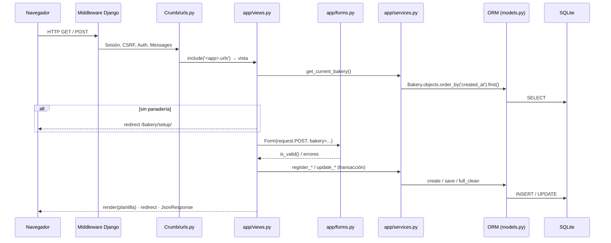
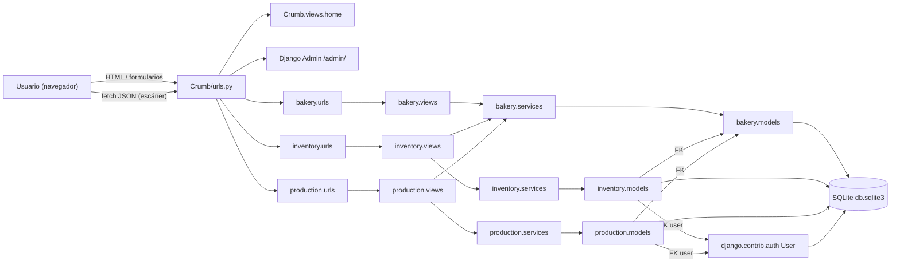
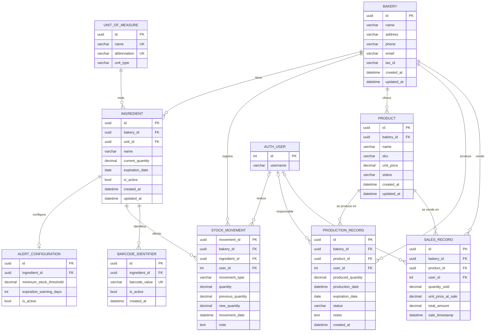

# Crumb — Documento Técnico

> Documento generado a partir del código fuente actual del repositorio `JANDRESMh2/Crumb`
> (rama `main`, Sprint 3 — Django 6.0.7, Python ≥ 3.12, SQLite).

---

## 1. Resumen Ejecutivo

**Crumb** es una aplicación web para la **gestión operativa de una panadería**. Cubre dos grandes áreas:

1. **Inventario de materias primas (ingredientes):** existencias, unidades de medida, caducidades, entradas, consumos, correcciones manuales auditadas, alertas y códigos de barras.
2. **Producción y ventas de productos terminados:** catálogo de productos, registro diario de producción, registro diario de ventas e historial combinado.

### Objetivos del sistema

| Área | Objetivo | Requisito(s) |
|---|---|---|
| Panadería | Registrar el perfil comercial (configuración inicial) | FR09, DR04 |
| Inventario | Registrar, editar, listar y eliminar (lógicamente) ingredientes | FR01, FR03, FR04, FR05 |
| Inventario | Catálogo fijo de unidades de medida (kg, g, u, L) | FR02, DR01 |
| Inventario | Registrar entradas de stock (compras) | FR07 |
| Inventario | Registrar consumos sin permitir stock negativo | FR08, DR03 |
| Inventario | Corregir manualmente el stock dejando registro de auditoría | FR23, DR02 |
| Inventario | Alertas de caducidad y de stock bajo; umbral mínimo configurable | FR06, FR10, FR11 |
| Inventario | Buscar por nombre y filtrar por rango de caducidad | FR22, FR24 |
| Inventario | Importación masiva desde Excel/CSV | FR15 |
| Inventario | Códigos de barras en el alta y entrada por escaneo continuo | FR17, FR18 |
| Producción | Catálogo de productos terminados (precio, SKU, estado) | FR12 |
| Producción | Registro diario de producción | FR12 |
| Ventas | Registro diario de ventas con precio histórico | FR13 |
| Producción / Ventas | Historial combinado con filtros y totales | FR25 |

### Alcance actual

- **Un solo tenant por despliegue.** Todavía no hay gestión de usuarios propia (FR31 pendiente). La panadería "actual" es la primera fila de `Bakery` ([get_current_bakery](file:///c:/Users/andres/Documents/Proyecto_P1/Crumb/bakery/services.py#L18-L19)).
- Los campos `user` de movimientos, producción y ventas son opcionales (`NULL`) hasta que exista FR31; la corrección manual guarda el usuario si hay sesión de Django iniciada.
- Interfaz **renderizada en el servidor** (plantillas Django) con un único endpoint JSON (escaneo de códigos de barras).
- Producción y ventas **aún no descuentan ingredientes** del inventario (no hay recetas); son módulos independientes que solo comparten la panadería.

---

## 2. Arquitectura del Sistema

### 2.1 Stack tecnológico

| Capa | Tecnología |
|---|---|
| Lenguaje | Python 3.12+ (probado en 3.14.3) |
| Framework web | Django 6.0.7 (patrón MTV: Model–Template–View) |
| Base de datos | SQLite (`db.sqlite3`) a través del ORM de Django |
| Archivos Excel/CSV | `pandas` 3.0.6 + `openpyxl` 3.1.5 (y sus dependencias `numpy`, `python-dateutil`, `et_xmlfile`, `six`) |
| Frontend | Plantillas Django + CSS propio en `base.html` + JavaScript nativo (`fetch`) |
| Servidor | WSGI (`Crumb/wsgi.py`) / ASGI (`Crumb/asgi.py`); `runserver` en desarrollo |

### 2.2 Estructura del proyecto

```text
Crumb/                          ← raíz del repositorio
├── manage.py                   ← CLI de Django (runserver, migrate, test…)
├── requirements.txt            ← dependencias fijadas
├── db.sqlite3                  ← base de datos
├── docs/                       ← documentación (este archivo)
├── Crumb/                      ← paquete de configuración del proyecto
│   ├── settings.py             ← apps instaladas, BD, middleware, plantillas
│   ├── urls.py                 ← enrutador raíz
│   ├── views.py                ← vista "home"
│   └── wsgi.py / asgi.py
├── bakery/                     ← app: perfil de la panadería (tenant)
│   ├── models.py forms.py services.py views.py urls.py admin.py
│   ├── migrations/             ← 0001
│   └── templates/bakery/       ← setup.html, detail.html
├── inventory/                  ← app: inventario de ingredientes
│   ├── models.py forms.py services.py views.py urls.py admin.py
│   ├── migrations/             ← 0001 … 0008 (incluye siembra de unidades)
│   └── templates/inventory/    ← listado, formularios, importación, corrección…
├── production/                 ← app: productos, producción, ventas e historial
│   ├── models.py forms.py services.py views.py urls.py admin.py
│   ├── migrations/             ← 0001 … 0003
│   └── templates/production/   ← product_*, production_*, sales_*, history_tracking
├── templates/                  ← plantillas globales
│   ├── base.html               ← layout, navegación y estilos
│   ├── home.html
│   └── partials/field.html
└── apps/                       ← esqueleto de carpetas vacías (accounts, inventory,
                                   operations, production, sales); NO registrado
                                   en INSTALLED_APPS
```

### 2.3 Componentes principales

Cada app de Django sigue la misma arquitectura en capas:

| Capa | Archivo | Responsabilidad |
|---|---|---|
| Enrutamiento | `urls.py` | Asocia URL → vista. Usa *namespaces* (`bakery:`, `inventory:`, `production:`). |
| Controlador | `views.py` | Obtiene la panadería actual, valida con formularios, invoca servicios y responde con plantilla, redirección o JSON. |
| Validación | `forms.py` | Limpieza y reglas de entrada (nombres únicos, stock suficiente, código de barras libre, motivo obligatorio…). |
| Lógica de negocio | `services.py` | Operaciones transaccionales (`@transaction.atomic`) y cálculos (alertas, totales, historial). |
| Persistencia | `models.py` | Entidades ORM y restricciones de BD (`UniqueConstraint`, `CheckConstraint`). |
| Presentación | `templates/` | HTML renderizado en el servidor; todas heredan de `base.html`. |
| Administración | `admin.py` | Panel `/admin/` de Django. |

| App | Propósito | Depende de |
|---|---|---|
| `bakery` | Perfil comercial (entidad raíz/tenant) | — |
| `inventory` | Ingredientes, movimientos de stock, alertas, códigos de barras | `bakery` |
| `production` | Productos, producción diaria, ventas diarias, historial | `bakery` |

`inventory` y `production` **no dependen entre sí**; ambas cuelgan de `bakery` y usan `get_current_bakery()` en cada vista. `inventory` y `production` también referencian `settings.AUTH_USER_MODEL` (usuario de Django) para la auditoría.

**Apps instaladas** ([settings.py](file:///c:/Users/andres/Documents/Proyecto_P1/Crumb/Crumb/settings.py)): las contrib de Django (`admin`, `auth`, `contenttypes`, `sessions`, `messages`, `staticfiles`) + `bakery` + `inventory` + `production`.

### 2.4 Conexión con la base de datos

Definida en [settings.py](file:///c:/Users/andres/Documents/Proyecto_P1/Crumb/Crumb/settings.py):

```python
DATABASES = {
    'default': {
        'ENGINE': 'django.db.backends.sqlite3',
        'NAME': BASE_DIR / 'db.sqlite3',
    }
}
```

- Todo el acceso a datos pasa por el **ORM de Django**; no hay SQL manual.
- El esquema se versiona con **migraciones** (`python manage.py migrate`):
  - `bakery/0001_initial`
  - `inventory/0001` → `0008` (`0002_seed_units_of_measure` inserta Kilogram/kg, Gram/g, Unit/u, Liter/L; `0008_stock_movement_correction_audit` añade los campos de auditoría de FR23)
  - `production/0001` → `0003` (productos, alineación con el Entregable 1, `SalesRecord`)
- Las operaciones que tocan varias filas/tablas (p. ej. actualizar stock + crear movimiento) se ejecutan dentro de `transaction.atomic`.
- Los servicios de `production` llaman a `full_clean()` antes de guardar, de modo que las validaciones del modelo se aplican también fuera de los formularios.
- Cambiar a PostgreSQL/MySQL solo requiere modificar `DATABASES`; el código no usa características específicas de SQLite.

### 2.5 Flujo de una petición



### 2.6 Diagrama de componentes



### 2.7 Navegación de la interfaz

`base.html` muestra la barra superior con: **Bakery profile** (`bakery:detail`), **Ingredients** (`inventory:list`) y **Production** (`production:list`). `home.html` ofrece accesos directos al perfil, alta de ingrediente, entrada de stock y listado de ingredientes.

### 2.8 Middleware y seguridad

`SecurityMiddleware`, `SessionMiddleware`, `CommonMiddleware`, `CsrfViewMiddleware`, `AuthenticationMiddleware`, `MessageMiddleware`, `XFrameOptionsMiddleware`.

- **CSRF** activo en todos los POST, incluido el endpoint JSON (el JS envía `X-CSRFToken`).
- Los mensajes de éxito/error se transmiten con el framework `messages`.
- Configuración de desarrollo: `DEBUG = True`, `SECRET_KEY` en el código y `ALLOWED_HOSTS = []`; deben cambiarse antes de un despliegue en producción.

---

## 3. Modelo de Datos

Todas las claves primarias son **UUID** (`uuid4`). Las tablas siguen la convención de Django `<app>_<modelo>`.

### 3.1 Diagrama entidad-relación



### 3.2 App `bakery`

#### `bakery_bakery` — [Bakery](file:///c:/Users/andres/Documents/Proyecto_P1/Crumb/bakery/models.py)
Entidad raíz (tenant) con el perfil comercial.

| Campo | Tipo | Reglas |
|---|---|---|
| `id` | UUID | PK |
| `name` | CharField(150) | Obligatorio |
| `address` | CharField(255) | Obligatorio |
| `phone` | CharField(20) | Opcional; regex `^\+?[0-9 ()-]{7,20}$` |
| `email` | EmailField | Opcional |
| `tax_id` | CharField(50) | Opcional |
| `created_at` / `updated_at` | DateTime | Automáticos |

### 3.3 App `inventory` ([models.py](file:///c:/Users/andres/Documents/Proyecto_P1/Crumb/inventory/models.py))

#### `inventory_unitofmeasure` — UnitOfMeasure
Catálogo de referencia, sembrado por migración.

| Campo | Tipo | Reglas |
|---|---|---|
| `name` | CharField(30) | Único |
| `abbreviation` | CharField(10) | Único; `CHECK abbreviation IN ('kg','g','u','L')` |
| `unit_type` | CharField(10) | `mass` \| `volume` \| `count` |

#### `inventory_ingredient` — Ingredient

| Campo | Tipo | Reglas |
|---|---|---|
| `bakery_id` | FK → Bakery | `PROTECT` |
| `unit_id` | FK → UnitOfMeasure | `PROTECT` |
| `name` | CharField(120) | `UNIQUE(bakery, name)` |
| `current_quantity` | Decimal(10,2) | `CHECK >= 0` |
| `expiration_date` | Date | Obligatorio |
| `is_active` | Boolean | `False` = baja lógica (FR04) |
| `created_at` / `updated_at` | DateTime | Automáticos |

Propiedad calculada: `active_barcode` (código de barras activo, si lo hay).

#### `inventory_alertconfiguration` — AlertConfiguration
Relación **1:1** con Ingredient (`CASCADE`). Sin fila = sin alertas.

| Campo | Tipo | Reglas |
|---|---|---|
| `minimum_stock_threshold` | Decimal(10,2) nullable | `NULL` o `> 0` |
| `expiration_warning_days` | PositiveInteger nullable | `NULL` o `>= 0` |
| `is_active` | Boolean | Por defecto `True` |

Restricción: al menos uno de los dos umbrales debe tener valor; los servicios borran la fila si ambos quedan vacíos.

#### `inventory_stockmovement` — StockMovement
Kardex/auditoría de todos los cambios de stock.

| Campo | Tipo | Reglas |
|---|---|---|
| `movement_id` | UUID | PK |
| `bakery_id` | FK → Bakery | `CASCADE` |
| `ingredient_id` | FK → Ingredient | `PROTECT` |
| `user_id` | FK → auth User | Nullable, `SET_NULL` (FR23/DR02) |
| `movement_type` | CharField(20) | `StockIn` \| `Consumption` \| `Correction` \| `Loss` |
| `quantity` | Decimal(10,2) | `CHECK > 0` (en correcciones = diferencia absoluta) |
| `previous_quantity` | Decimal(10,2) nullable | Stock antes de la corrección (FR23) |
| `new_quantity` | Decimal(10,2) nullable | Stock después de la corrección (FR23) |
| `movement_date` | DateTime | Automático |
| `note` | Text | Opcional; en correcciones guarda el **motivo** |

> `Loss` está definido pero todavía no tiene flujo en la interfaz.

#### `inventory_barcodeidentifier` — BarcodeIdentifier

| Campo | Tipo | Reglas |
|---|---|---|
| `ingredient_id` | FK → Ingredient | `CASCADE` |
| `barcode_value` | CharField(64) | Único global |
| `is_active` | Boolean | Se desactiva al dar de baja el ingrediente |
| `created_at` | DateTime | Automático |

### 3.4 App `production` ([models.py](file:///c:/Users/andres/Documents/Proyecto_P1/Crumb/production/models.py))

#### `production_product` — Product
Producto terminado de la panadería.

| Campo | Tipo | Reglas |
|---|---|---|
| `bakery_id` | FK → Bakery | `PROTECT` |
| `name` | CharField(120) | `UNIQUE(bakery, name)` |
| `sku` | CharField(50) | Opcional |
| `unit_price` | Decimal(10,2) | `>= 0` |
| `status` | CharField(10) | `Active` \| `Inactive` (por defecto `Active`) |
| `created_at` / `updated_at` | DateTime | Automáticos |

Propiedad de compatibilidad `is_active` (lectura/escritura sobre `status`).

#### `production_productionrecord` — ProductionRecord (FR12)

| Campo | Tipo | Reglas |
|---|---|---|
| `bakery_id` | FK → Bakery | `PROTECT` |
| `product_id` | FK → Product | `PROTECT` |
| `user_id` | FK → auth User | Nullable, `SET_NULL` |
| `produced_quantity` | Decimal(10,2) | `CHECK > 0` |
| `production_date` | DateTime | Por defecto `now` |
| `expiration_date` | Date | Opcional |
| `status` | CharField(10) | `Completed` \| `Cancelled` |
| `notes` | Text | Opcional |
| `created_at` | DateTime | Automático |

Orden por defecto: `-production_date, -created_at`.

#### `production_salesrecord` — SalesRecord (FR13)

| Campo | Tipo | Reglas |
|---|---|---|
| `bakery_id` | FK → Bakery | `PROTECT` |
| `product_id` | FK → Product | `PROTECT` |
| `user_id` | FK → auth User | Nullable, `SET_NULL` |
| `quantity_sold` | Decimal(10,2) | `CHECK > 0` |
| `unit_price_at_sale` | Decimal(10,2) | `CHECK >= 0`; **foto** del precio al vender |
| `total_amount` | Decimal(12,2) | `CHECK >= 0`; `quantity_sold × unit_price_at_sale` redondeado a 2 decimales (`ROUND_HALF_UP`) |
| `sale_timestamp` | DateTime | Por defecto `now` |

Orden por defecto: `-sale_timestamp`.

### 3.5 Reglas de negocio sobre los datos

**Inventario**
- **Stock nunca negativo:** validado en formulario, en servicio (`InsufficientStockError` / `InventoryCorrectionError`) y en BD (`CHECK`).
- **Baja lógica:** `deactivate_ingredient` pone `is_active=False` y desactiva sus códigos de barras.
- **Reactivación:** registrar un nombre igual (sin distinguir mayúsculas) a uno inactivo reutiliza la fila.
- **Corrección manual (FR23):** exige cantidad distinta a la actual, `>= 0` y un motivo; guarda cantidad anterior, nueva, motivo y usuario.
- **Alertas** (calculadas al listar, no persistidas): stock bajo (`current_quantity < minimum_stock_threshold`), por caducar (`0 ≤ días ≤ expiration_warning_days`) y caducado (`expiration_date < hoy`).

**Producción y ventas**
- Solo productos `Active` de la panadería actual pueden usarse en producción o ventas.
- Registrar un producto con el nombre de uno `Inactive` lo reactiva con los nuevos datos.
- El precio de venta se congela en `unit_price_at_sale`, así los cambios de precio posteriores no alteran ventas pasadas.
- El historial (FR25) solo suma en los totales la producción en estado `Completed`.

### 3.6 Tablas de Django (contrib)

`auth_user`, `auth_group`, `auth_permission` y tablas intermedias, `django_session`, `django_content_type`, `django_admin_log`, `django_migrations`.

---

## 4. Interfaces / API

### 4.1 Enrutamiento raíz

[Crumb/urls.py](file:///c:/Users/andres/Documents/Proyecto_P1/Crumb/Crumb/urls.py):

```python
urlpatterns = [
    path('admin/',      admin.site.urls),
    path('',            views.home,                                       name='home'),
    path('bakery/',     include('bakery.urls',     namespace='bakery')),
    path('inventory/',  include('inventory.urls',  namespace='inventory')),
    path('production/', include('production.urls', namespace='production')),
]
```

Todas las vistas de `inventory` y `production` (y `bakery:detail`) **redirigen a `/bakery/setup/`** si aún no hay panadería configurada; el endpoint JSON responde `400` en ese caso. Los POST de formularios exitosos siguen el patrón *Post/Redirect/Get*.

### 4.2 Endpoints — General y `bakery`

| Método | Ruta | Nombre | Vista | Respuesta | Req. |
|---|---|---|---|---|---|
| GET | `/` | `home` | `Crumb.views.home` | HTML `home.html` | — |
| * | `/admin/` | `admin:*` | Django Admin | HTML | — |
| GET / POST | `/bakery/setup/` | `bakery:setup` | `bakery_setup` | HTML / redirect `bakery:detail` | FR09 |
| GET | `/bakery/` | `bakery:detail` | `bakery_detail` | HTML | FR09 |

### 4.3 Endpoints — `inventory` ([urls.py](file:///c:/Users/andres/Documents/Proyecto_P1/Crumb/inventory/urls.py))

| Método | Ruta | Nombre | Vista | Respuesta | Req. |
|---|---|---|---|---|---|
| GET | `/inventory/ingredients/` | `inventory:list` | `ingredient_list` | HTML con alertas | FR05, FR06, FR11, FR22, FR24 |
| GET / POST | `/inventory/ingredients/new/` | `inventory:create` | `ingredient_create` | HTML / redirect | FR01, FR17 |
| GET / POST | `/inventory/ingredients/<uuid>/edit/` | `inventory:edit` | `ingredient_edit` | HTML / redirect | FR03 |
| GET / POST | `/inventory/ingredients/<uuid>/delete/` | `inventory:delete` | `ingredient_delete` | GET confirma · POST elimina | FR04 |
| GET / POST | `/inventory/ingredients/<uuid>/low-stock-threshold/` | `inventory:low_stock_threshold_configuration` | `low_stock_threshold_configuration` | HTML / redirect | FR10 |
| GET / POST | `/inventory/ingredients/<uuid>/correction/` | `inventory:manual_inventory_correction` | `manual_inventory_correction` | HTML (+ últimas 10 correcciones) / redirect | FR23 |
| GET / POST | `/inventory/stock-in/` | `inventory:stock_in` | `stock_in_create` | HTML / redirect | FR07, FR18 |
| GET / POST | `/inventory/stock-consumption/` | `inventory:stock_consumption` | `Stock_consumption_registration` | HTML / redirect | FR08 |
| GET / POST | `/inventory/ingredients/import/` | `inventory:import` | `ingredient_import_view` | HTML / redirect | FR15 |
| GET | `/inventory/ingredients/import/template/` | `inventory:import_template` | `download_import_template_view` | Archivo `.xlsx` | FR15 |
| POST | `/inventory/api/stock-in-barcode/` | `inventory:stock_in_barcode_scan` | `stock_in_barcode_scan` | **JSON** | FR18 |

### 4.4 Endpoints — `production` ([urls.py](file:///c:/Users/andres/Documents/Proyecto_P1/Crumb/production/urls.py))

| Método | Ruta | Nombre | Vista | Respuesta | Req. |
|---|---|---|---|---|---|
| GET | `/production/` | `production:list` | `production_list` | HTML listado de producción | FR12 |
| GET / POST | `/production/register/` | `production:register` | `daily_production_registration` | HTML / redirect `production:list` | FR12 |
| GET | `/production/products/` | `production:product_list` | `product_list` | HTML catálogo | FR12 |
| GET / POST | `/production/products/new/` | `production:product_create` | `product_create` | HTML / redirect `production:register` | FR12 |
| GET / POST | `/production/products/<uuid>/edit/` | `production:product_edit` | `product_edit` | HTML / redirect `production:product_list` | FR12 |
| GET | `/production/sales/` | `production:sales_list` | `sales_list` | HTML listado de ventas | FR13 |
| GET / POST | `/production/sales/register/` | `production:sales_register` | `daily_sales_registration` | HTML / redirect `production:sales_list` | FR13 |
| GET | `/production/history-tracking/` | `production:history_tracking` | `history_tracking` | HTML historial + totales | FR25 |

### 4.5 Detalle de formularios y parámetros

`*` = obligatorio.

| Endpoint (POST salvo indicación) | Campos / parámetros | Lógica invocada |
|---|---|---|
| `/bakery/setup/` | `name`*, `address`*, `phone`, `email`, `tax_id` | `setup_bakery_profile` (error si ya existe) |
| `GET /inventory/ingredients/` | `q` (nombre, `icontains`), `start_date`, `end_date` (`YYYY-MM-DD`, caducidad) | `expiration_date_range_filter`, `low_stock_alerts`, `expiration_alerts`, `is_ingredient_expired` |
| `/inventory/ingredients/new/` | `name`*, `unit`* (UUID), `current_quantity`*, `expiration_date`*, `expiration_warning_days`, `barcode_value` | `register_ingredient` |
| `/inventory/ingredients/<uuid>/edit/` | Igual que alta, sin `barcode_value` | `update_ingredient` |
| `/inventory/ingredients/<uuid>/delete/` | — | `deactivate_ingredient` |
| `/inventory/ingredients/<uuid>/low-stock-threshold/` | `minimum_stock_threshold` (≥ 0.01; vacío = quitar) | `configure_low_stock_threshold` |
| `/inventory/ingredients/<uuid>/correction/` | `new_quantity`* (≥ 0, distinta a la actual), `reason`* | `register_inventory_correction` |
| `/inventory/stock-in/` | `ingredient`*, `quantity`*, `note` | Suma stock + `StockMovement(StockIn)` en la vista (transacción) |
| `/inventory/stock-consumption/` | `ingredient`*, `quantity`*, `note` | `register_stock_consumption` |
| `/inventory/ingredients/import/` | `file`* (`.xlsx`, `.xls`, `.csv`; `multipart/form-data`) | `import_ingredients_from_excel` |
| `/production/products/new/` | `name`*, `sku`, `unit_price`* | `register_product` (crea o reactiva) |
| `/production/products/<uuid>/edit/` | `name`*, `sku`, `unit_price`*, `status`* | `ProductEditForm.save()` |
| `/production/register/` | `product`* (solo activos), `produced_quantity`*, `production_date`* (`datetime-local`) | `register_daily_production` |
| `/production/sales/register/` | `product`* (solo activos), `quantity_sold`*, `sale_timestamp`* (`datetime-local`) | `register_daily_sale` |
| `GET /production/history-tracking/` | `type` (`all` \| `production` \| `sales`), `product` (UUID), `start_date`, `end_date` | `build_history_tracking` |

#### Columnas de importación (FR15)

| Columna en archivo | Campo interno | Obligatoria |
|---|---|---|
| `Nombre` | `name` | Sí |
| `Unidad` (nombre o abreviatura) | `unit` | Sí |
| `Cantidad` | `quantity` | Sí |
| `Fecha de caducidad` | `expiration_date` | Sí |
| `Dias de aviso de caducidad` | `expiration_warning_days` | No |
| `Codigo de barras` | `barcode` | No |

Si el ingrediente ya existe (activo), **suma** la cantidad y actualiza fecha y unidad; si no, lo crea.

> [!WARNING]
> La plantilla de `/inventory/ingredients/import/template/` genera encabezados en inglés (`Name`, `Unit`, `Quantity`, `Expiration date`, …). `Expiration date` se normaliza a `expiration date` (con espacio) y no coincide con `expiration_date`, por lo que importar la plantilla sin modificar falla con *"Missing required columns"*. Conviene alinear los encabezados de la plantilla con el `column_mapping` de `import_ingredients_from_excel` en [services.py](file:///c:/Users/andres/Documents/Proyecto_P1/Crumb/inventory/services.py).

### 4.6 API JSON — `POST /inventory/api/stock-in-barcode/`

Lo usa el "modo escáner" de `stock_in_form.html` mediante `fetch`. Decoradores: `@require_POST`, `@transaction.atomic`.

**Cabeceras**
```http
Content-Type: application/json
X-CSRFToken: <token>
```

**Cuerpo**
```json
{ "barcode": "7501234567890", "quantity": "2" }
```
`quantity` es opcional (por defecto `"1"`) y debe ser `> 0`.

**Respuesta 200**
```json
{
  "success": true,
  "ingredient_name": "Harina",
  "unit": "kg",
  "added": "2",
  "new_total": "27.00"
}
```

**Errores**

| Código | Cuerpo | Causa |
|---|---|---|
| 400 | `{"error": "Set up the bakery profile before registering stock."}` | No hay panadería |
| 400 | `{"error": "Invalid request format."}` | JSON o cantidad inválidos |
| 400 | `{"error": "Quantity must be positive."}` | `quantity <= 0` |
| 400 | `{"error": "No barcode provided."}` | Código vacío |
| 404 | `{"error": "The scanned barcode is not registered. ..."}` | Código no vinculado a un ingrediente activo |
| 403 | — | Token CSRF ausente o inválido |
| 405 | — | Método distinto de POST |

Efecto: suma la cantidad al ingrediente y crea un `StockMovement` `StockIn` con nota `"Continuous scan"`.

### 4.7 Capa de servicios (interfaz interna)

Funciones que las vistas usan para comunicarse con la lógica de negocio (argumentos *keyword-only*).

| Módulo | Función | Descripción |
|---|---|---|
| [bakery/services.py](file:///c:/Users/andres/Documents/Proyecto_P1/Crumb/bakery/services.py) | `get_current_bakery()` | Panadería actual (primera creada) o `None` |
| | `setup_bakery_profile(...)` | Crea el perfil; `BakeryAlreadyConfigured` si ya existe |
| [inventory/services.py](file:///c:/Users/andres/Documents/Proyecto_P1/Crumb/inventory/services.py) | `register_ingredient(...)` | Alta o reactivación + alerta de caducidad + código de barras |
| | `update_ingredient(...)` | Edición + alerta de caducidad |
| | `deactivate_ingredient(ingredient)` | Baja lógica + desactiva códigos |
| | `register_stock_consumption(...)` | Consumo; `InsufficientStockError` si no hay stock |
| | `register_inventory_correction(...)` | Corrección auditada; `InventoryCorrectionError` si es inválida |
| | `configure_low_stock_threshold(...)` | Crea/actualiza/elimina umbral mínimo |
| | `configure_expiration_alert(...)` | Crea/actualiza/elimina aviso de caducidad |
| | `low_stock_alerts` / `expiration_alerts` / `is_ingredient_expired` | Cálculo de alertas |
| | `import_ingredients_from_excel(file, bakery)` | Importación masiva → `(creados, actualizados)` |
| [production/services.py](file:///c:/Users/andres/Documents/Proyecto_P1/Crumb/production/services.py) | `register_product(bakery, name, unit_price, sku)` | Crea o reactiva un producto; `ValidationError` si ya está activo |
| | `register_daily_production(bakery, product, produced_quantity, production_date)` | Crea `ProductionRecord` `Completed` |
| | `register_daily_sale(bakery, product, quantity_sold, sale_timestamp, user)` | Crea `SalesRecord` con precio congelado y total calculado |
| | `build_history_tracking(bakery, record_type, product, start_date, end_date)` | Historial combinado (más reciente primero) + totales `produced_quantity`, `sold_quantity`, `sales_amount` |

### 4.8 Panel de administración

`/admin/` (requiere `python manage.py createsuperuser`) expone `Bakery`, `Ingredient`, `UnitOfMeasure` y `BarcodeIdentifier`. **No** están registrados `AlertConfiguration`, `StockMovement` ni ningún modelo de `production` (`production/admin.py` está vacío).
